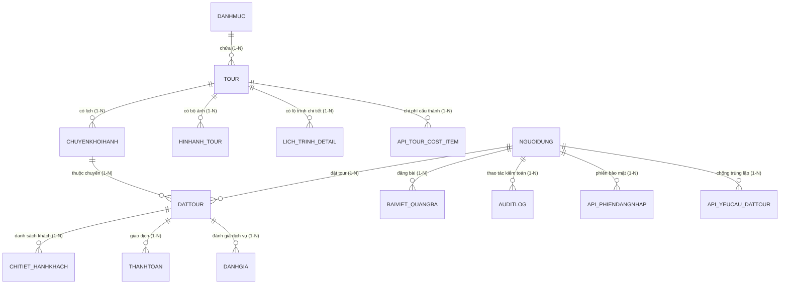

# DELTA TRAVEL - DATABASE SCHEMA & TÀI LIỆU CẤU TRÚC CƠ SỞ DỮ LIỆU
**Hệ quản trị CSDL:** Microsoft SQL Server (SmarterASP.NET - `sql8020.site4now.net:1433`)  
**Tên Database:** `db_ad0b71_dattour`  
**Đặc tả:** 100% Cấu trúc chuẩn ERD Tiếng Việt gốc - Bảo toàn toàn vẹn thực thể, quan hệ và thuộc tính.

---

## 📌 NGUYÊN TẮC BẢO TOÀN CẤU TRÚC DATABASE (BẮT BUỘC TUÂN THỦ)

1. **Giữ nguyên các thực thể (Entities):** Tuyệt đối không tự ý thêm, xóa hoặc đổi tên các bảng hiện có trong database.
2. **Giữ nguyên các mối quan hệ (Relationships):** Bảo toàn 100% quan hệ 1-1, 1-N, N-N và các khóa ngoại (Foreign Key).
3. **Giữ nguyên các thuộc tính (Attributes):** Không xóa, không đổi tên hoặc thay đổi kiểu dữ liệu, độ dài và thuộc tính NULL/NOT NULL của các cột.
4. **Giữ nguyên khóa:** Giữ nguyên khóa chính (PK), khóa ngoại (FK), khóa duy nhất (UK) và các ràng buộc toàn vẹn dữ liệu.
5. **Không phá vỡ ERD:** Cấu trúc database luôn đồng bộ và tương thích với bản vẽ thiết kế ERD đã hoàn thành.
6. **Ưu tiên xử lý tại Backend/Frontend:** Khi cần mở rộng tính năng, tối ưu hóa code backend, query SQL hoặc controller frontend, không tạo thêm bảng dư thừa.
7. **Bảo toàn dữ liệu:** Không thực hiện DROP TABLE, TRUNCATE TABLE hoặc xóa dữ liệu nghiệp vụ của đồ án.

---

## 🗺️ BIỂU ĐỒ QUAN HỆ THỰC THỂ (ERD RELATIONSHIPS)

---

## 📋 CHI TIẾT 15 BẢNG CƠ SỞ DỮ LIỆU HIỆN HỮU

### 1. Bảng `NGUOIDUNG` (Tài khoản người dùng & Khách hàng)
Lưu trữ thông tin người dùng, tài khoản đăng nhập, khách hàng và quản trị viên.

| Tên Cột | Kiểu Dữ Liệu | NULL / NOT NULL | Mô Tả & Ràng Buộc |
| :--- | :--- | :--- | :--- |
| **`MaNguoiDung`** | `int` (IDENTITY) | **NOT NULL** | **Khóa chính (PK)** |
| `HoTen` | `nvarchar(100)` | NOT NULL | Họ và tên người dùng |
| `Email` | `nvarchar(150)` | NOT NULL | Địa chỉ email (Định danh duy nhất) |
| `SoDienThoai` | `nvarchar(20)` | YES | Số điện thoại liên hệ |
| `MatKhau` | `nvarchar(255)` | NOT NULL | Mật khẩu hash bảo mật |
| `DiaChi` | `nvarchar(255)` | YES | Địa chỉ liên hệ / thường trú |
| `TrangThai` | `nvarchar(30)` | NOT NULL | Trạng thái: `HoatDong`, `Khoa` (Mặc định: `'HoatDong'`) |
| `NgayTao` | `datetime` | NOT NULL | Thời gian tạo tài khoản |
| `VaiTro` | `nvarchar(30)` | NOT NULL | Quyền hạn: `KhachHang`, `Admin` (Mặc định: `'KhachHang'`) |

---

### 2. Bảng `DANHMUC` (Danh mục phân loại tour)
Phân loại tour theo vùng miền (Miền Bắc, Miền Trung, Miền Nam, Tour đặc biệt).

| Tên Cột | Kiểu Dữ Liệu | NULL / NOT NULL | Mô Tả & Ràng Buộc |
| :--- | :--- | :--- | :--- |
| **`MaDanhMuc`** | `int` (IDENTITY) | **NOT NULL** | **Khóa chính (PK)** |
| `TenDanhMuc` | `nvarchar(100)` | NOT NULL | Tên danh mục (VD: Tour Miền Bắc, Tour Miền Trung...) |
| `MoTa` | `nvarchar(500)` | YES | Mô tả ngắn gọn về danh mục |

---

### 3. Bảng `TOUR` (Thông tin gói tour du lịch)
Lưu trữ toàn bộ thông tin sản phẩm du lịch trọn gói của Delta Travel.

| Tên Cột | Kiểu Dữ Liệu | NULL / NOT NULL | Mô Tả & Ràng Buộc |
| :--- | :--- | :--- | :--- |
| **`MaTour`** | `int` (IDENTITY) | **NOT NULL** | **Khóa chính (PK)** |
| `MaDanhMuc` | `int` | NOT NULL | **Khóa ngoại (FK)** tham chiếu `DANHMUC(MaDanhMuc)` |
| `TenTour` | `nvarchar(200)` | NOT NULL | Tên đầy đủ của tour du lịch |
| `MoTaChiTiet` | `nvarchar(max)` | YES | Mô tả tổng quan, điểm đặc sắc, trải nghiệm |
| `LichTrinhTongQuan`| `nvarchar(max)` | YES | Lịch trình tóm tắt sơ bộ |
| `GiaKhuyenNghi` | `decimal(18,2)` | NOT NULL | Giá bán niêm yết khuyến nghị |
| `HinhAnhDaiDien` | `nvarchar(500)` | YES | Đường dẫn ảnh đại diện chính |
| `TrangThai` | `nvarchar(30)` | NOT NULL | Trạng thái: `HoatDong`, `TamDung` (Mặc định: `'HoatDong'`) |
| `Slug` | `nvarchar(200)` | YES | Định danh URL thân thiện SEO |
| `Duration` | `nvarchar(50)` | YES | Thời lượng hành trình (VD: `3N2Đ`, `4N3Đ`) |
| `Departure` | `nvarchar(200)` | YES | Điểm đón / khởi hành (Hà Nội, TP.HCM...) |
| `Transport` | `nvarchar(200)` | YES | Phương tiện chính (Du thuyền, Máy bay, Limousine...) |
| `GiaGoc` | `decimal(18,2)` | YES | Giá gốc trước khuyến mãi |
| `FlashSale` | `bit` | YES | Đánh dấu tour Flash Sale (`1` hoặc `0`) |

---

### 4. Bảng `CHUYENKHOIHANH` (Lịch khởi hành & Quản lý chỗ)
Quản lý các chuyến đi thực tế của từng tour theo ngày khởi hành cụ thể.

| Tên Cột | Kiểu Dữ Liệu | NULL / NOT NULL | Mô Tả & Ràng Buộc |
| :--- | :--- | :--- | :--- |
| **`MaChuyen`** | `int` (IDENTITY) | **NOT NULL** | **Khóa chính (PK)** |
| `MaTour` | `int` | NOT NULL | **Khóa ngoại (FK)** tham chiếu `TOUR(MaTour)` |
| `NgayKhoiHanh` | `date` | NOT NULL | Ngày bắt đầu khởi hành chuyến đi |
| `NgayKetThuc` | `date` | NOT NULL | Ngày kết thúc chuyến đi |
| `GiaThucTe` | `decimal(18,2)` | NOT NULL | Giá vé thực tế của chuyến đi này |
| `SoChoToiDa` | `int` | NOT NULL | Tổng số lượng chỗ tối đa của chuyến |
| `SoChoDaDat` | `int` | NOT NULL | Số chỗ đã được khách đặt thành công (Mặc định: `0`) |
| `TrangThaiChuyen` | `nvarchar(30)` | NOT NULL | `MoBan`, `HetCho`, `HoanTat`, `Huy` |

---

### 5. Bảng `HINHANH_TOUR` (Thư viện hình ảnh tour)
Bộ sưu tập các hình ảnh chất lượng cao đi kèm theo từng tour.

| Tên Cột | Kiểu Dữ Liệu | NULL / NOT NULL | Mô Tả & Ràng Buộc |
| :--- | :--- | :--- | :--- |
| **`MaHinhAnh`** | `int` (IDENTITY) | **NOT NULL** | **Khóa chính (PK)** |
| `MaTour` | `int` | NOT NULL | **Khóa ngoại (FK)** tham chiếu `TOUR(MaTour)` |
| `DuongDanAnh` | `nvarchar(500)` | NOT NULL | Đường dẫn file ảnh / CDN |
| `GhiChu` | `nvarchar(200)` | YES | Chú thích ảnh (VD: Sundeck du thuyền, Vịnh Lan Hạ...) |

---

### 6. Bảng `LICH_TRINH_DETAIL` (Lịch trình chi tiết từng ngày)
Lưu chi tiết lộ trình sáng, trưa, tối, địa điểm và hoạt động của từng ngày trong tour.

| Tên Cột | Kiểu Dữ Liệu | NULL / NOT NULL | Mô Tả & Ràng Buộc |
| :--- | :--- | :--- | :--- |
| **`MaLichTrinh`** | `int` (IDENTITY) | **NOT NULL** | **Khóa chính (PK)** |
| `MaTour` | `int` | NOT NULL | **Khóa ngoại (FK)** tham chiếu `TOUR(MaTour)` |
| `NgayThu` | `int` | NOT NULL | Số thứ tự ngày (Ngày 1, Ngày 2...) |
| `TieuDeNgay` | `nvarchar(200)` | NOT NULL | Tiêu đề tóm tắt ngày trải nghiệm |
| `NoiDungChiTiet` | `nvarchar(max)` | NOT NULL | Nội dung chi tiết các hoạt động trong ngày |
| `BuaAn` | `nvarchar(200)` | YES | Thông tin bữa ăn trong ngày (Sáng, Trưa, Tối) |
| `ThuTuTrongNgay` | `int` | YES | Thứ tự hoạt động |
| `LoaiHoatDong` | `nvarchar(50)` | YES | Loại hình: Tham quan, Di chuyển, Ăn uống, Nghỉ ngơi |
| `DiaDiem` | `nvarchar(200)` | YES | Tên địa danh / tọa độ tham quan |
| `GioBatDau` | `nvarchar(20)` | YES | Mốc giờ dự kiến (VD: 08:00, 14:00...) |

---

### 7. Bảng `DATTOUR` (Đơn đặt chỗ tour)
Quản lý các đơn đặt vé của khách hàng, số lượng khách, tổng tiền và tiến độ xử lý.

| Tên Cột | Kiểu Dữ Liệu | NULL / NOT NULL | Mô Tả & Ràng Buộc |
| :--- | :--- | :--- | :--- |
| **`MaDatTour`** | `int` (IDENTITY) | **NOT NULL** | **Khóa chính (PK)** |
| `MaKhachHang` | `int` | NOT NULL | **Khóa ngoại (FK)** tham chiếu `NGUOIDUNG(MaNguoiDung)` |
| `MaChuyen` | `int` | NOT NULL | **Khóa ngoại (FK)** tham chiếu `CHUYENKHOIHANH(MaChuyen)` |
| `NgayDat` | `datetime` | NOT NULL | Thời gian tạo đơn đặt tour |
| `SoLuongKhach` | `int` | NOT NULL | Tổng số lượng hành khách trong đoàn |
| `TongTien` | `decimal(18,2)` | NOT NULL | Tổng giá trị đơn đặt tour (VND) |
| `TrangThaiDat` | `nvarchar(30)` | NOT NULL | `ChoXacNhan`, `DaXacNhan`, `HoanTat`, `DaHuy` |
| `TrangThaiThanhToan` | `nvarchar(30)` | NOT NULL | `ChuaThanhToan`, `DaThanhToan`, `HoanTien` |

---

### 8. Bảng `CHITIET_HANHKHACH` (Danh sách hành khách tham gia)
Lưu trữ họ tên, ngày sinh, giới tính và liên hệ của từng thành viên đi trong đơn tour.

| Tên Cột | Kiểu Dữ Liệu | NULL / NOT NULL | Mô Tả & Ràng Buộc |
| :--- | :--- | :--- | :--- |
| **`MaHanhKhach`** | `int` (IDENTITY) | **NOT NULL** | **Khóa chính (PK)** |
| `MaDatTour` | `int` | NOT NULL | **Khóa ngoại (FK)** tham chiếu `DATTOUR(MaDatTour)` |
| `HoTen` | `nvarchar(100)` | NOT NULL | Họ và tên hành khách |
| `NgaySinh` | `date` | YES | Ngày sinh (để kiểm tra độ tuổi vé trẻ em / bảo hiểm) |
| `GioiTinh` | `nvarchar(10)` | YES | Giới tính: `Nam`, `Nữ` |
| `SoDienThoai` | `nvarchar(20)` | YES | Số điện thoại hành khách |

---

### 9. Bảng `THANHTOAN` (Đối soát giao dịch thanh toán)
Ghi nhận các khoản thanh toán thực tế của đơn đặt tour qua các cổng / chuyển khoản.

| Tên Cột | Kiểu Dữ Liệu | NULL / NOT NULL | Mô Tả & Ràng Buộc |
| :--- | :--- | :--- | :--- |
| **`MaThanhToan`** | `int` (IDENTITY) | **NOT NULL** | **Khóa chính (PK)** |
| `MaDatTour` | `int` | NOT NULL | **Khóa ngoại (FK)** tham chiếu `DATTOUR(MaDatTour)` |
| `PhuongThuc` | `nvarchar(50)` | NOT NULL | Hình thức: `ChuyenKhoan`, `TheTinDung`, `TienMat` |
| `SoTien` | `decimal(18,2)` | NOT NULL | Số tiền thanh toán (VND) |
| `NgayThanhToan` | `datetime` | NOT NULL | Thời gian xác nhận giao dịch |
| `MaGiaoDich` | `nvarchar(100)` | YES | Mã tham chiếu ngân hàng / cổng thanh toán |
| `TrangThai` | `nvarchar(30)` | NOT NULL | `ThanhCong`, `ThatBai`, `DangXuLy` |

---

### 10. Bảng `DANHGIA` (Đánh giá & Phản hồi chất lượng tour)
Đánh giá số sao, cảm nhận thực tế và phản hồi từ phía quản trị viên.

| Tên Cột | Kiểu Dữ Liệu | NULL / NOT NULL | Mô Tả & Ràng Buộc |
| :--- | :--- | :--- | :--- |
| **`MaDanhGia`** | `int` (IDENTITY) | **NOT NULL** | **Khóa chính (PK)** |
| `MaDatTour` | `int` | NOT NULL | **Khóa ngoại (FK)** tham chiếu `DATTOUR(MaDatTour)` |
| `SoSao` | `int` | NOT NULL | Điểm đánh giá (1 đến 5 sao) |
| `NoiDung` | `nvarchar(1000)`| YES | Lời nhận xét, cảm nhận chuyến đi |
| `HinhAnh` | `nvarchar(500)` | YES | Ảnh check-in thực tế đính kèm của khách |
| `NgayDanhGia` | `datetime` | NOT NULL | Thời điểm gửi đánh giá |
| `TrangThaiHienThi` | `bit` | NOT NULL | Cho phép hiển thị ra website (`1` hoặc `0`) |
| `PhanHoiAdmin` | `nvarchar(1000)`| YES | Lời hồi đáp cảm ơn từ quản lý Delta Travel |

---

### 11. Bảng `BAIVIET_QUANGBA` (Cẩm nang du lịch & Quảng bá)
Lưu các bài viết tin tức, cẩm nang khám phá và khuyến mãi của Delta Travel.

| Tên Cột | Kiểu Dữ Liệu | NULL / NOT NULL | Mô Tả & Ràng Buộc |
| :--- | :--- | :--- | :--- |
| **`MaBaiViet`** | `int` (IDENTITY) | **NOT NULL** | **Khóa chính (PK)** |
| `TieuDe` | `nvarchar(250)` | NOT NULL | Tiêu đề bài viết |
| `Slug` | `nvarchar(250)` | NOT NULL | Định danh đường dẫn web SEO |
| `TomTat` | `nvarchar(500)` | YES | Tóm tắt bài viết |
| `NoiDung` | `nvarchar(max)` | NOT NULL | Nội dung chi tiết bài viết (HTML / Markdown) |
| `HinhAnhDaiDien` | `nvarchar(500)` | YES | Ảnh bìa bài viết |
| `LuotXem` | `int` | NOT NULL | Số lượt người xem (Mặc định: `0`) |
| `NgayTao` | `datetime` | NOT NULL | Ngày đăng tải bài viết |
| `TrangThai` | `nvarchar(30)` | NOT NULL | `XuatBan`, `BanNhap` |
| `MaNguoiDang` | `int` | NOT NULL | **Khóa ngoại (FK)** tham chiếu `NGUOIDUNG(MaNguoiDung)` |

---

### 12. Bảng `AUDITLOG` (Nhật ký kiểm toán hệ thống)
Ghi nhận mọi thao tác quan trọng để đảm bảo tính minh bạch và an toàn dữ liệu.

| Tên Cột | Kiểu Dữ Liệu | NULL / NOT NULL | Mô Tả & Ràng Buộc |
| :--- | :--- | :--- | :--- |
| **`MaLog`** | `int` (IDENTITY) | **NOT NULL** | **Khóa chính (PK)** |
| `MaNguoiThucHien` | `int` | YES | **Khóa ngoại (FK)** tham chiếu `NGUOIDUNG(MaNguoiDung)` |
| `HanhDong` | `nvarchar(100)` | NOT NULL | Tên hành động (VD: Đăng nhập, Tạo đơn, Hủy đơn...) |
| `DuLieuCu` | `nvarchar(max)` | YES | Dữ liệu trạng thái cũ (JSON / Text) |
| `DuLieuMoi` | `nvarchar(max)` | YES | Dữ liệu trạng thái mới (JSON / Text) |
| `ThoiGian` | `datetime` | NOT NULL | Thời điểm xảy ra thao tác (Mặc định: `GETDATE()`) |

---

### 13. Bảng `API_PHIENDANGNHAP` (Bảo mật phiên đăng nhập)
Quản lý Token xác thực JWT / Bearer bảo mật cho từng người dùng.

| Tên Cột | Kiểu Dữ Liệu | NULL / NOT NULL | Mô Tả & Ràng Buộc |
| :--- | :--- | :--- | :--- |
| **`TokenHash`** | `char(64)` | **NOT NULL** | **Khóa chính (PK)** |
| `MaNguoiDung` | `int` | NOT NULL | **Khóa ngoại (FK)** tham chiếu `NGUOIDUNG(MaNguoiDung)` |
| `CsrfHash` | `char(64)` | NOT NULL | Token chống giả mạo request CSRF |
| `HetHan` | `datetime2` | NOT NULL | Thời gian hết hạn phiên đăng nhập |

---

### 14. Bảng `API_TOUR_COST_ITEM` (Khoản mục chi phí cấu thành tour)
Phân tích cơ cấu giá thành tour phục vụ minh bạch giá cả.

| Tên Cột | Kiểu Dữ Liệu | NULL / NOT NULL | Mô Tả & Ràng Buộc |
| :--- | :--- | :--- | :--- |
| **`MaKhoanChi`** | `int` | **NOT NULL** | **Khóa chính (PK)** |
| `MaTour` | `int` | NOT NULL | **Khóa ngoại (FK)** tham chiếu `TOUR(MaTour)` |
| `DanhMuc` | `nvarchar(40)` | NOT NULL | Hạng mục chi phí (Vận chuyển, Lưu trú, Ăn uống...) |
| `TenKhoanChi` | `nvarchar(150)` | NOT NULL | Tên khoản chi tiết |
| `GhiChu` | `nvarchar(2000)`| NOT NULL | Diễn giải chi tiết |
| `ChiPhiMoiNguoi` | `bigint` | NOT NULL | Chi phí đơn vị tính trên 1 khách (VND) |

---

### 15. Bảng `API_YEUCAU_DATTOUR` (Chống lặp đơn Idempotency)
Ngăn chặn click nhiều lần gây trùng lặp đơn đặt tour khi khách nhấn đặt giữ chỗ.

| Tên Cột | Kiểu Dữ Liệu | NULL / NOT NULL | Mô Tả & Ràng Buộc |
| :--- | :--- | :--- | :--- |
| `MaNguoiDung` | `int` | NOT NULL | **Khóa ngoại (FK)** tham chiếu `NGUOIDUNG(MaNguoiDung)` |
| `KhoaYeuCau` | `uniqueidentifier` | NOT NULL | UUID Idempotency Key duy nhất của yêu cầu |
| `DauVanTay` | `char(64)` | NOT NULL | Hash dữ liệu đơn tour |
| `MaDatTour` | `int` | YES | **Khóa ngoại (FK)** tham chiếu `DATTOUR(MaDatTour)` |
| `TaoLuc` | `datetime2` | NOT NULL | Thời gian ghi nhận yêu cầu |

---

## 🔒 CAM KẾT ĐẢM BẢO CHẤT LƯỢNG HỆ THỐNG
1. Toàn bộ 8 bảng tiếng Anh dư thừa (`favorites`, `audit_log`, `bookings`, `itinerary_items`, `schedules`, `tours`, `sessions`, `users`) đã được loại bỏ hoàn toàn khỏi cơ sở dữ liệu SQL Server.
2. Cơ sở dữ liệu hiện tại chỉ bao gồm duy nhất 15 bảng nghiệp vụ gốc, bảo toàn 100% dữ liệu, khóa chính, khóa ngoại và quan hệ ERD đã thiết kế.
3. Mọi chức năng mở rộng phía giao diện người dùng (chuyển đổi đa ngôn ngữ Việt - Anh, biểu tượng cờ SVG, thanh điều hướng kính Liquid Glass, khung chat AI Concierge) đều tuân thủ nguyên tắc không can thiệp làm biến đổi cấu trúc bảng trong CSDL.

