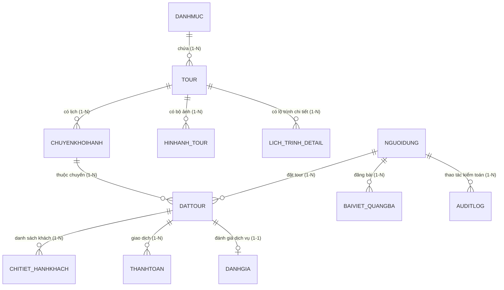

# DELTA TRAVEL - CƠ SỞ DỮ LIỆU CHUẨN 12 BẢNG (3NF)
**Hệ quản trị CSDL:** Microsoft SQL Server (SmarterASP.NET - `sql8020.site4now.net:1433`)  
**Tên Database:** `db_ad0b71_dattour`  
**Phạm vi:** Mô tả 12 bảng **nghiệp vụ gốc** của ERD. Không khẳng định tổng số bảng vật lý, cột mở rộng hay việc đã kiểm chứng trực tiếp SmarterASP. Ba bảng hạ tầng tùy chọn `API_PHIENDANGNHAP`, `API_YEUCAU_DATTOUR`, `API_TOUR_COST_ITEM` thuộc các migration SQL Server riêng và không nằm trong 12 bảng nghiệp vụ gốc.

---

## 📌 NGUYÊN TẮC BẢO TOÀN CẤU TRÚC DATABASE

1. **Giữ nguyên các thực thể (Entities):** Chỉ có đúng 12 bảng nghiệp vụ theo đặc tả. Tuyệt đối không thêm, xóa hoặc đổi tên bất kỳ bảng nào.
2. **Giữ nguyên các mối quan hệ (Relationships):** Bảo toàn 100% các quan hệ 1-1, 1-N và các khóa ngoại (Foreign Key).
3. **Giữ nguyên các thuộc tính (Attributes):** Chỉ có đúng các cột được định nghĩa trong tài liệu thiết kế. Không tự ý thêm bất kỳ cột phụ nào vào bảng.
4. **Giữ nguyên khóa:** Đảm bảo toàn vẹn Khóa chính (PK), Khóa ngoại (FK), Khóa duy nhất (UK) và các ràng buộc toàn vẹn.
5. **Không phá vỡ ERD:** Kiểm tra metadata SQL Server thực tế (bảng, cột, khóa, FK) so với ERD trước khi khẳng định hai bên đồng bộ.
6. **Không làm mất dữ liệu:** Không xóa dữ liệu có sẵn của đồ án. Chỉ thêm mới và đọc dữ liệu.

---

## 🗺️ BIỂU ĐỒ QUAN HỆ THỰC THỂ (ERD RELATIONSHIPS - 12 BẢNG CHUẨN)

---

## 📋 CHI TIẾT 12 BẢNG NGHIỆP VỤ THEO TÀI LIỆU THIẾT KẾ

### 1. Bảng `NGUOIDUNG` (Thông tin tài khoản & Phân quyền người dùng)
Quản lý danh sách tài khoản khách hàng và nhân viên hệ thống.

| Tên Cột | Kiểu Dữ Liệu | Ràng Buộc | Mô Tả |
| :--- | :--- | :--- | :--- |
| **`MaNguoiDung`** | `INT` (IDENTITY) | **Khóa chính (PK)** | Mã định danh người dùng tự tăng |
| `HoTen` | `NVARCHAR(100)` | NOT NULL | Họ và tên đầy đủ |
| `Email` | `VARCHAR(100)` | UNIQUE, NOT NULL | Địa chỉ email đăng nhập |
| `SoDienThoai` | `VARCHAR(15)` | NOT NULL | Số điện thoại liên lạc |
| `MatKhau` | `VARCHAR(255)` | NOT NULL | Mật khẩu tài khoản (Hash) |
| `DiaChi` | `NVARCHAR(200)` | NULL | Địa chỉ cư trú |
| `TrangThai` | `BIT` | DEFAULT 1 | 1: Hoạt động, 0: Khóa |
| `NgayTao` | `DATETIME` | DEFAULT GETDATE() | Thời gian đăng ký tài khoản |

---

### 2. Bảng `DANHMUC` (Danh mục du lịch / Điểm đến)
Phân loại các tour du lịch theo vùng miền, chủ đề hoặc địa bàn hoạt động.

| Tên Cột | Kiểu Dữ Liệu | Ràng Buộc | Mô Tả |
| :--- | :--- | :--- | :--- |
| **`MaDanhMuc`** | `INT` (IDENTITY) | **Khóa chính (PK)** | Mã định danh danh mục |
| `TenDanhMuc` | `NVARCHAR(100)` | NOT NULL | Tên danh mục (Miền Bắc, Miền Trung, Miền Nam...) |
| `MoTa` | `NVARCHAR(MAX)` | NULL | Mô tả thông tin điểm đến / chủ đề |

---

### 3. Bảng `TOUR` (Thông tin tổng quan tour du lịch)
Lưu trữ thông tin cơ bản và niêm yết của các gói sản phẩm tour du lịch.

| Tên Cột | Kiểu Dữ Liệu | Ràng Buộc | Mô Tả |
| :--- | :--- | :--- | :--- |
| **`MaTour`** | `INT` (IDENTITY) | **Khóa chính (PK)** | Mã định danh gói tour |
| `MaDanhMuc` | `INT` | **Khóa ngoại (FK)** -> `DANHMUC(MaDanhMuc)` | Danh mục vùng miền trực thuộc |
| `TenTour` | `NVARCHAR(200)` | NOT NULL | Tên đầy đủ của chuyến du lịch |
| `MoTaChiTiet` | `NVARCHAR(MAX)` | NULL | Giới thiệu chi tiết điểm nổi bật |
| `LichTrinhTongQuan` | `NVARCHAR(500)` | NULL | Tóm tắt lịch trình hành trình |
| `GiaKhuyenNghi` | `DECIMAL(18,2)` | NOT NULL | Giá bán niêm yết tham khảo (VND) |
| `HinhAnhDaiDien` | `VARCHAR(255)` | NULL | Đường dẫn file ảnh đại diện |
| `TrangThai` | `BIT` | DEFAULT 1 | 1: Đang mở bán, 0: Tạm dừng |

---

### 4. Bảng `HINHANH_TOUR` (Bộ sưu tập hình ảnh Slide Gallery của Tour)
Lưu trữ các hình ảnh chụp thực tế phục vụ hiển thị slide gallery trên giao diện chi tiết tour.

| Tên Cột | Kiểu Dữ Liệu | Ràng Buộc | Mô Tả |
| :--- | :--- | :--- | :--- |
| **`MaHinhAnh`** | `INT` (IDENTITY) | **Khóa chính (PK)** | Mã hình ảnh tự tăng |
| `MaTour` | `INT` | **Khóa ngoại (FK)** -> `TOUR(MaTour)` | Tour du lịch sở hữu hình ảnh |
| `DuongDanAnh` | `VARCHAR(255)` | NOT NULL | Đường dẫn ảnh CDN/Local |
| `GhiChu` | `NVARCHAR(200)` | NULL | Chú thích bức ảnh |

---

### 5. Bảng `LICH_TRINH_DETAIL` (Lịch trình chi tiết từng ngày của Tour)
Lộ trình chi tiết từng ngày: Ngày 1, Ngày 2, Ngày 3... các hoạt động và bữa ăn tương ứng.

| Tên Cột | Kiểu Dữ Liệu | Ràng Buộc | Mô Tả |
| :--- | :--- | :--- | :--- |
| **`MaLichTrinh`** | `INT` (IDENTITY) | **Khóa chính (PK)** | Mã định danh lịch trình ngày |
| `MaTour` | `INT` | **Khóa ngoại (FK)** -> `TOUR(MaTour)` | Tour du lịch trực thuộc |
| `NgayThu` | `INT` | NOT NULL | Thứ tự ngày trong tour (1, 2, 3...) |
| `TieuDeNgay` | `NVARCHAR(200)` | NOT NULL | Tiêu đề hành trình trong ngày |
| `NoiDungChiTiet` | `NVARCHAR(MAX)` | NOT NULL | Nội dung chi tiết các điểm đến |
| `BuaAn` | `NVARCHAR(100)` | NULL | Thực đơn bữa ăn (Sáng, Trưa, Tối) |

---

### 6. Bảng `CHUYENKHOIHANH` (Lịch khởi hành cụ thể của từng Tour)
Quản lý lịch xuất phát, số chỗ tối đa và số chỗ đã đặt theo từng đợt mở bán.

| Tên Cột | Kiểu Dữ Liệu | Ràng Buộc | Mô Tả |
| :--- | :--- | :--- | :--- |
| **`MaChuyen`** | `INT` (IDENTITY) | **Khóa chính (PK)** | Mã chuyến đi |
| `MaTour` | `INT` | **Khóa ngoại (FK)** -> `TOUR(MaTour)` | Tour áp dụng lịch khởi hành này |
| `NgayKhoiHanh` | `DATETIME` | NOT NULL | Thời điểm khởi hành |
| `NgayKetThuc` | `DATETIME` | NOT NULL | Thời điểm kết thúc chuyến đi |
| `GiaThucTe` | `DECIMAL(18,2)` | NOT NULL | Giá vé thực tế áp dụng cho đợt này |
| `SoChoToiDa` | `INT` | NOT NULL | Số lượng chỗ tối đa có thể phục vụ |
| `SoChoDaDat` | `INT` | DEFAULT 0 | Số lượng khách đã đặt giữ chỗ thành công |
| `TrangThaiChuyen` | `NVARCHAR(50)` | DEFAULT N'Mở bán' | Trạng thái: Mở bán, Hết chỗ, Đã hoàn tất |

---

### 7. Bảng `DATTOUR` (Đơn đặt tour du lịch)
Quản lý toàn bộ giao dịch đặt vé của khách hàng, tiến độ thanh toán và tình trạng xử lý đơn.

| Tên Cột | Kiểu Dữ Liệu | Ràng Buộc | Mô Tả |
| :--- | :--- | :--- | :--- |
| **`MaDatTour`** | `INT` (IDENTITY) | **Khóa chính (PK)** | Mã đơn đặt chỗ tự tăng |
| `MaKhachHang` | `INT` | **Khóa ngoại (FK)** -> `NGUOIDUNG(MaNguoiDung)` | Khách hàng thực hiện đặt đơn |
| `MaChuyen` | `INT` | **Khóa ngoại (FK)** -> `CHUYENKHOIHANH(MaChuyen)` | Chuyến đi được đặt |
| `NgayDat` | `DATETIME` | DEFAULT GETDATE() | Thời điểm gửi yêu cầu đặt |
| `SoLuongKhach` | `INT` | NOT NULL | Tổng số khách đăng ký |
| `TongTien` | `DECIMAL(18,2)` | NOT NULL | Tổng giá trị đơn đặt tour |
| `TrangThaiDat` | `NVARCHAR(50)` | DEFAULT N'Chờ xác nhận' | 'Chờ xác nhận', 'Đã xác nhận', 'Đã hoàn thành', 'Đã hủy' |
| `TrangThaiThanhToan` | `NVARCHAR(50)` | DEFAULT N'Chưa thanh toán' | 'Chưa thanh toán', 'Đã cọc', 'Đã thanh toán', 'Đã hoàn tiền' |

---

### 8. Bảng `CHITIET_HANHKHACH` (Danh sách hành khách đi cùng trong đơn đặt)
Thông tin cụ thể của từng cá nhân hành khách tham gia trong đơn đặt chỗ.

| Tên Cột | Kiểu Dữ Liệu | Ràng Buộc | Mô Tả |
| :--- | :--- | :--- | :--- |
| **`MaHanhKhach`** | `INT` (IDENTITY) | **Khóa chính (PK)** | Mã hành khách tự tăng |
| `MaDatTour` | `INT` | **Khóa ngoại (FK)** -> `DATTOUR(MaDatTour)` | Thuộc về đơn đặt tour nào |
| `HoTen` | `NVARCHAR(100)` | NOT NULL | Họ tên của hành khách |
| `NgaySinh` | `DATE` | NULL | Ngày tháng năm sinh |
| `GioiTinh` | `NVARCHAR(10)` | NULL | Giới tính (Nam / Nữ / Khác) |
| `SoDienThoai` | `VARCHAR(15)` | NULL | Số điện thoại cá nhân |

---

### 9. Bảng `THANHTOAN` (Lịch sử giao dịch thanh toán)
Quản lý các đợt thu tiền, phương thức chuyển khoản/tiền mặt và mã giao dịch ngân hàng.

| Tên Cột | Kiểu Dữ Liệu | Ràng Buộc | Mô Tả |
| :--- | :--- | :--- | :--- |
| **`MaThanhToan`** | `INT` (IDENTITY) | **Khóa chính (PK)** | Mã giao dịch thanh toán |
| `MaDatTour` | `INT` | **Khóa ngoại (FK)** -> `DATTOUR(MaDatTour)` | Đơn tour được thanh toán |
| `PhuongThuc` | `NVARCHAR(50)` | NOT NULL | 'Chuyển khoản QR', 'Tiền mặt', 'Thẻ tín dụng' |
| `SoTien` | `DECIMAL(18,2)` | NOT NULL | Số tiền thanh toán thực tế (VND) |
| `NgayThanhToan` | `DATETIME` | DEFAULT GETDATE() | Thời gian ghi nhận giao dịch |
| `MaGiaoDich` | `VARCHAR(100)` | NULL | Mã đối soát ngân hàng / ví điện tử |
| `TrangThai` | `NVARCHAR(50)` | DEFAULT N'Thành công' | Trạng thái: 'Thành công', 'Thất bại', 'Đang xử lý' |

---

### 10. Bảng `DANHGIA` (Đánh giá & Nhận xét của đơn tour)
Phản hồi chất lượng tour của khách hàng sau khi hoàn tất chuyến đi (quan hệ 1-1 với đơn hoàn thành).

| Tên Cột | Kiểu Dữ Liệu | Ràng Buộc | Mô Tả |
| :--- | :--- | :--- | :--- |
| **`MaDanhGia`** | `INT` (IDENTITY) | **Khóa chính (PK)** | Mã bài đánh giá |
| `MaDatTour` | `INT` | **UNIQUE, Khóa ngoại (FK)** -> `DATTOUR(MaDatTour)` | Mỗi đơn hoàn thành chỉ đánh giá 01 lần |
| `SoSao` | `TINYINT` | CHECK(SoSao BETWEEN 1 AND 5) | Số sao đánh giá từ 1 đến 5 |
| `NoiDung` | `NVARCHAR(1000)` | NULL | Nhận xét chi tiết của du khách |
| `HinhAnh` | `NVARCHAR(500)` | NULL | Đường dẫn ảnh đính kèm |
| `NgayDanhGia` | `DATETIME` | DEFAULT GETDATE() | Thời điểm gửi phản hồi |
| `TrangThaiHienThi` | `BIT` | DEFAULT 1 | 1: Hiển thị công khai, 0: Ẩn |
| `PhanHoiAdmin` | `NVARCHAR(1000)` | NULL | Phản hồi từ ban quản trị Delta Travel |

---

### 11. Bảng `BAIVIET_QUANGBA` (Bài viết & Nội dung truyền thông du lịch)
Cẩm nang du lịch, bài viết quảng bá điểm đến, tin tức khuyến mãi và hướng dẫn trải nghiệm.

| Tên Cột | Kiểu Dữ Liệu | Ràng Buộc | Mô Tả |
| :--- | :--- | :--- | :--- |
| **`MaBaiViet`** | `INT` (IDENTITY) | **Khóa chính (PK)** | Mã bài viết tự tăng |
| `TieuDe` | `NVARCHAR(255)` | NOT NULL | Tiêu đề bài viết |
| `Slug` | `VARCHAR(255)` | NULL | Đường dẫn thân thiện SEO |
| `TomTat` | `NVARCHAR(500)` | NULL | Tóm tắt nội dung bài viết |
| `NoiDung` | `NVARCHAR(MAX)` | NOT NULL | Toàn văn nội dung bài viết |
| `HinhAnhDaiDien` | `VARCHAR(255)` | NULL | Ảnh bìa đại diện bài viết |
| `LuotXem` | `INT` | DEFAULT 0 | Tổng số lượt đọc |
| `NgayTao` | `DATETIME` | DEFAULT GETDATE() | Ngày giờ đăng bài |
| `TrangThai` | `BIT` | DEFAULT 1 | 1: Công khai, 0: Ẩn |
| `MaNguoiDang` | `INT` | **Khóa ngoại (FK)** -> `NGUOIDUNG(MaNguoiDung)` | Tài khoản tác giả đăng bài |

---

### 12. Bảng `AUDITLOG` (Nhật ký thao tác hệ thống & Bảo mật)
Ghi nhận toàn bộ vết lịch sử thao tác dữ liệu (tạo, cập nhật, hủy, duyệt đơn) phục vụ kiểm toán an toàn.

| Tên Cột | Kiểu Dữ Liệu | Ràng Buộc | Mô Tả |
| :--- | :--- | :--- | :--- |
| **`MaLog`** | `INT` (IDENTITY) | **Khóa chính (PK)** | Mã bản ghi log tự tăng |
| `MaNguoiThucHien` | `INT` | **Khóa ngoại (FK)** -> `NGUOIDUNG(MaNguoiDung)`, NULL | Người dùng thực hiện thao tác |
| `HanhDong` | `NVARCHAR(100)` | NOT NULL | Tên hành vi (VD: Login, CreateBooking, Pay) |
| `DuLieuCu` | `NVARCHAR(MAX)` | NULL | Trạng thái dữ liệu trước khi thay đổi |
| `DuLieuMoi` | `NVARCHAR(MAX)` | NULL | Trạng thái dữ liệu sau khi thay đổi |
| `ThoiGian` | `DATETIME` | DEFAULT GETDATE() | Thời điểm ghi nhận thao tác |

---

## 🔒 XÁC NHẬN BẢO TOÀN CƠ SỞ DỮ LIỆU
1. **Chưa đối soát được SQL Server thực tế:** Danh sách 12 bảng ở trên là đặc tả thiết kế, **không phải xác nhận đã đọc metadata** từ `db_ad0b71_dattour`. Thắm cần chạy `database/database/scripts/sqlserver_schema_preflight_readonly.sql` trên đúng database để ghi nhận bảng, cột, ràng buộc và migration hiện hữu.
2. **Quy tắc vận hành:** Backend phải tương thích schema **đã được xác minh**, bảo toàn dữ liệu; không được chạy script có `DROP TABLE` lên production. Chức năng phiên, chống trùng đơn và quản trị có thể yêu cầu cơ chế hạ tầng bổ sung, phải được cả nhóm phê duyệt trước khi migration.

## 🧭 TRẠNG THÁI ĐỐI SOÁT 09/11/2026

- `database/database/01_schema/02_create_tables_3nf.sql` là script khởi tạo cũ, có lệnh `DROP TABLE`. **Không được chạy lại trên DB thật có dữ liệu.**
- Migration staging `001_auth_sessions_idempotency.sql` tạo `API_PHIENDANGNHAP` và `API_YEUCAU_DATTOUR`, `002_admin_and_catalog_management.sql` tạo `API_TOUR_COST_ITEM` và một số cột mở rộng. **Chưa có bằng chứng cả ba đã hiện diện ở SmarterASP production.**
- Bản báo cáo 12 bảng gộp `TokenHash/CsrfHash/HetHan` vào `NGUOIDUNG` và `KhoaYeuCau/DauVanTay` vào `DATTOUR` là phương án khác với migration dùng bảng riêng, **không dùng đồng thời khi chưa có ADR**.
- Để kiểm tra, xem [báo cáo đối soát](docs/SCHEMA_RECONCILIATION_20261109.md) và [script preflight chỉ đọc](database/database/scripts/sqlserver_schema_preflight_readonly.sql).
- Kiểm thử SQL Server dùng database CI tạm thời **không chứng minh** SmarterASP đã chạy API ghi đơn/thanh toán thực.
