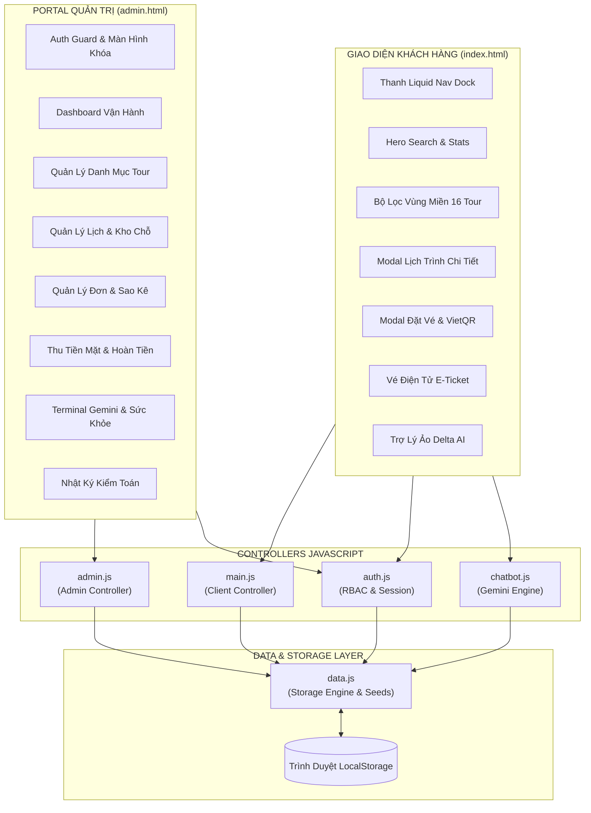

# ĐẶC TẢ KIẾN TRÚC & CẤU TRÚC FRONTEND DELTA TRAVEL 2.0
> **Tài liệu Kỹ thuật Kiến trúc Phần Mềm Frontend (Frontend Technical Specification)**  
> **Dự án:** Hệ Thống Đặt Tour Du Lịch & Portal Điều Hành Vận Trị Delta Travel  
> **Phiên bản:** 2.0 (Pure Frontend Edition)

---

## I. TỔNG QUAN KIẾN TRÚC FRONTEND

Hệ thống được xây dựng theo mô hình **Single-File Pure Frontend Architecture** kết hợp với **Client-side Storage Layer**:
* **Không yêu cầu Backend runtime:** Hoạt động độc lập không cần Node.js, Express, PHP hay Python backend server.
* **Tầng lưu trữ cục bộ (Storage Layer):** Toàn bộ thực thể Tour, Lịch khởi hành, Đơn đặt chỗ (Bookings), Hóa đơn thanh toán (Payments) và Nhật ký kiểm toán (Audit Logs) được quản lý qua `LocalStorage` của trình duyệt.
* **Giao diện đa nền tảng (Responsive Design):** Xây dựng trên nền tảng Bootstrap 5.3.3 kết hợp hệ thống CSS tùy chỉnh hướng thành phần, hỗ trợ tốt trên Desktop (>= 1200px), Tablet (768px - 1199px) và Mobile (< 768px).

---

## II. DANH MỤC TẬP TIN & VAI TRÒ CHỨC NĂNG

### 1. Tập tin Giao diện Chính
| Tệp Tin | Kích Thước | Vai Trò & Chức Năng Chính |
| :--- | :---: | :--- |
| [`index.html`](file:///c:/Users/LeVanAn/Downloads/Compressed/deltatrdelt2.0-main/deltatrdelt2.0-main/index.html) | ~97 KB | Giao diện cổng thông tin khách hàng: Banner, thanh Liquid Dock lọc 3 miền, lưới 16 tour, quy trình đặt tour, VietQR, E-Ticket, Wishlist, Delta AI Chatbot. |
| [`admin.html`](file:///c:/Users/LeVanAn/Downloads/Compressed/deltatrdelt2.0-main/deltatrdelt2.0-main/admin.html) | ~40 KB | Portal Quản trị Vận hành: Màn hình khóa an toàn, 7 tab điều hành (Dashboard, Tours, Schedules, Bookings, Payments, AI Copilot, Audit Trail), công cụ thêm/sửa ảnh tour, xuất Excel CSV và In ấn A4. |

---

### 2. Mô-đun Phong Cách Giao Diện (`assets/css/`)
1. **`base.css`**: Định nghĩa biến toàn cục CSS (`:root`), bảng màu thương hiệu (Teal, Amber, Slate Dark), quy tắc reset chuẩn, kiểu cuộn mượt và typography.
2. **`header.css`**: Thiết kế thanh điều hướng Liquid Glass Dock trong suốt dạng viên nang bo tròn, đốm ngọc hổ phách active, logo thương hiệu chữ đen luxury và capsule tài khoản người dùng.
3. **`hero-search.css`**: Bố cục khu vực Hero Banner nền vịnh biển, thanh tìm kiếm nổi đa tiêu chí và các huy hiệu thống kê độ tin cậy của doanh nghiệp.
4. **`tour-cards.css`**: Hệ thống lưới hiển thị thẻ tour, tỷ lệ ảnh chuẩn 16:10, hiệu ứng hover mượt mà, huy hiệu danh thắng cảnh quan và cụm giá bán nổi bật.
5. **`sections.css`**: Khối nội dung giới thiệu điểm đến hấp dẫn, 3 trụ cột cam kết dịch vụ, cẩm nang du lịch và phản hồi thực tế từ khách hàng.
6. **`itinerary.css`**: Modal hiển thị lịch trình chi tiết: timeline dọc từng ngày, dịch vụ đã bao gồm/chưa bao gồm và các lưu ý du lịch quan trọng.
7. **`checkout.css`**: Bố cục modal đặt vé từng bước, khung hiển thị mã VietQR động, và mẫu vé điện tử (E-Ticket) có mã vạch chuẩn in ấn.
8. **`auth.css`**: Giao diện đăng nhập, đăng ký thành viên và quản lý hồ sơ cá nhân với kiểm tra tính hợp lệ dữ liệu trực tiếp.
9. **`chatbot.css`**: Cửa sổ Trợ lý ảo Delta AI góc phải màn hình, hiệu ứng bong bóng thoại hiện đại, danh sách gợi ý chủ đề 1 chạm.
10. **`admin.css`**: Giao diện quản trị cao cấp phong cách Dark Luxury & Gold, định dạng bảng số liệu, thanh AI Copilot strip và stylesheet riêng cho chế độ in báo cáo `@media print`.
11. **`responsive.css`**: Các quy tắc Media Queries tối ưu tỷ lệ hiển thị trên màn hình rộng, laptop, máy tính bảng và điện thoại thông minh.

---

### 3. Tầng Xử Lý Logic & Lưu Trữ (`assets/js/`)

#### 3.1. `data.js` - Cơ Sở Dữ Liệu Hạt Giống & Tầng Lưu Trữ (Storage Layer)
* **Khóa lưu trữ độc lập:** `delta_tours_v3`, `delta_schedules_v3`, `delta_bookings_v2`, `delta_payments_v2`, `delta_audit_logs_v2`, `delta_users_v2`.
* **Cơ sở dữ liệu 16 Tour Du Lịch:**
  * Miền Bắc (6 tour): Hạ Long (`DL-HL01`), Sa Pa (`DL-SP05`), Ninh Bình (`DL-NB07`), Hà Giang (`DL-HG08`), Cao Bằng (`DL-CB09`), Mộc Châu (`DL-MC10`).
  * Miền Trung (6 tour): Đà Nẵng (`DL-DN02`), Đà Lạt (`DL-DL04`), Huế (`DL-HU11`), Nha Trang (`DL-NT12`), Quy Nhơn (`DL-QN13`), Phú Yên (`DL-PY14`).
  * Miền Nam (4 tour): Phú Quốc (`DL-PQ03`), Cần Thơ Miền Tây (`DL-MT06`), Tây Ninh (`DL-TN15`), Côn Đảo (`DL-CD16`).
* **Tính trung thực của dữ liệu:** Không bịa đặt đơn hàng; danh sách `Bookings`, `Payments` và `AuditLogs` khởi tạo là mảng rỗng `[]`.
* **Hàm truy xuất dữ liệu an toàn:** `getToursData()`, `saveToursData()`, `getBookingsData()`, `saveBookingOrder()`, `updateBookingStatus()`, `getAuditLogsData()`, `addAuditLog()`.

#### 3.2. `main.js` - Bộ Điều Khiển Phân Hệ Khách Hàng
* **Quản lý trạng thái giao diện (`AppState`):** Theo dõi vùng miền đang lọc (`activeRegion`), từ khóa tìm kiếm (`searchKeyword`), mức giá (`selectedPriceRange`) và tiêu chí sắp xếp (`sortCriteria`).
* **Lọc vùng miền tức thì (`filterToursRegion`):** Đồng bộ trực tiếp 3 thành phần giao diện cùng lúc:
  1. Đốm ngọc kích hoạt trên thanh Liquid Nav Dock.
  2. Lớp `.active` trên các nút bấm `.filter-pill`.
  3. Giá trị chọn trong form Hero Search.
* **Tính toán giá động:** Tự động nhân hệ số người lớn (100%), trẻ em (75%), em bé (0%), trừ giá trị voucher và cập nhật hóa đơn theo thời gian thực.
* **Tích hợp thanh toán:** Sinh mã giao dịch ngẫu nhiên, sinh mã QR VietinBank theo cú pháp chuyển khoản và tự động tạo vé điện tử E-Ticket.

#### 3.3. `admin.js` - Bộ Điều Khiển Portal Quản Trị
* **Điều hướng 7 Tab Chức Năng (`switchAdminTab`):** Quản lý trạng thái hiển thị của các bảng dữ liệu mà không cần tải lại trang.
* **Bộ công cụ xử lý hình ảnh tour:**
  * Tải ảnh từ máy tính: Đọc file thành Base64 bằng `FileReader` để lưu trực tiếp vào LocalStorage.
  * Chọn ảnh thư viện: Nạp đường dẫn danh thắng nội bộ chuẩn mực.
  * URL ngoài: Hỗ trợ link ảnh web bất kỳ với khung Live Preview tức thì.
* **Xuất báo cáo doanh thu CSV:** Ghi thêm mã `\uFEFF` (BOM UTF-8) giúp file hiển thị tiếng Việt hoàn hảo trên Excel.
* **Quy trình Hủy đơn an toàn:** Bắt buộc nhập lý do hủy, ghi vết vào nhật ký kiểm toán và tự động hoàn trả chỗ trống vào kho tour.

#### 3.4. `auth.js` - Quản Lý Xác Thực & Phân Quyền (RBAC)
* Danh sách 5 thành viên nhóm phát triển Delta Travel được cấp quyền Quản Trị Viên `ADMIN`:
  1. **Hồng Thắm** (`hongtham@deltatravel.vn` - Trưởng nhóm)
  2. **Lê Văn An** (`an.levan@gmail.com`)
  3. **Lê Hải Đăng** (`haidang@deltatravel.vn`)
  4. **Nguyễn Phúc** (`nguyenphuc@deltatravel.vn`)
  5. **Mạnh Lê** (`manhle@deltatravel.vn`)
* Tự động điền thông tin khách hàng đã đăng nhập vào form đặt tour để giảm thiểu thao tác nhập liệu.

#### 3.5. `chatbot.js` - Trợ Lý Ảo Delta AI Concierge
* Kết nối trực tiếp mô hình **Google Gemini 2.5 Flash**.
* Cơ chế chuyên gia dự phòng nội bộ (Local Fallback Knowledge Engine) sẵn sàng tư vấn khi mất mạng hoặc không có API key.

---

## III. TÍNH NĂNG ĐÃ HOÀN THIỆN THEO YÊU CẦU

1. **Loại bỏ toàn bộ phần Sale & Flash Sale:**
   * Gỡ bỏ hoàn toàn khối đồng hồ đếm ngược `#flashSaleSection`.
   * Gỡ bỏ nút lọc `⚡ Đang Flash Sale` khỏi thanh điều khiển.
   * Gỡ bỏ nhãn tia chớp sale trên thẻ tour, thay bằng nhãn danh lam thắng cảnh trang nhã.
2. **Nút "Trợ lý AI" trên thanh Liquid Dock:**
   * Đồng bộ hàm toàn cục `window.openChatbot()` và `window.toggleChatbotWindow(true)`. Nhấp vào tab "✨ Trợ lý AI" sẽ mở ngay lập tức cửa sổ chat Gemini.
3. **Phân chia rõ ràng vùng miền Bắc – Trung – Nam:**
   * Miền Bắc lọc đúng 6 tour, Miền Trung lọc đúng 6 tour, Miền Nam lọc đúng 4 tour, Tất cả hiển thị 16 tour.
   * Tab active hiển thị đốm ngọc hổ phách và tự động cuộn mượt đến danh mục tour.
4. **Bổ sung đủ 10 Tour mới kèm ảnh thực tế:**
   * Đầy đủ 16 ảnh điểm đến thực tế, sắc nét, lưu trực tiếp tại [`assets/images/`](file:///c:/Users/LeVanAn/Downloads/Compressed/deltatrdelt2.0-main/deltatrdelt2.0-main/assets/images).
   * Đã sửa triệt để lỗi ảnh 404 của tour Mộc Châu (`tour-mocchau.jpg`) bằng hình ảnh đồi chè xanh mướt thực tế.
5. **Gỡ bỏ khối nút thành viên 1-click ở modal đăng nhập:**
   * Modal đăng nhập của khách hàng sạch sẽ, chuyên nghiệp, chuẩn giao diện người dùng thực tế.
6. **Bảo mật và tính xác thực dữ liệu ("CẤM BỊA THÔNG TIN"):**
   * Chỉ có đúng 5 thành viên trong nhóm làm quản trị viên.
   * Dữ liệu đơn hàng, đối soát thanh toán và nhật ký kiểm toán khởi tạo rỗng `[]`, sẵn sàng phục vụ kiểm thử thực tế.

