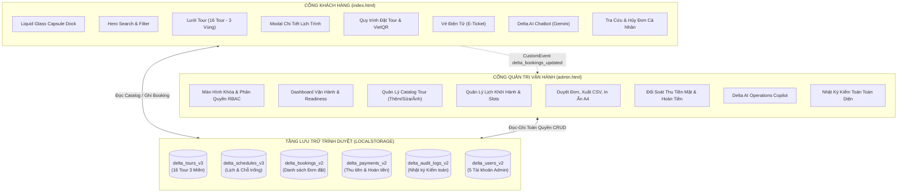

# BÁO CÁO CẤU TRÚC KIẾN TRÚC FRONTEND DELTA TRAVEL 2.0
> **Hệ Thống Đặt Tour Du Lịch & Nghỉ Dưỡng Cao Cấp Việt Nam (Client Web & Admin Operations Portal)**  
> **Công nghệ áp dụng:** Pure HTML5, Modern CSS3 (Flexbox/Grid/Glassmorphism), JavaScript ES6+ (Module-free, Vanilla JS), Bootstrap 5.3.3, Bootstrap Icons 1.11.3, Client-side Storage Layer (LocalStorage).  
> **Cam kết:** 100% Frontend thuần, không phụ thuộc backend runtime (Node.js/Python server), chạy trực tiếp trên mọi trình duyệt.

---

## 📑 MỤC LỤC CHI TIẾT
1. [Sơ Đồ Phân Bổ Cấu Trúc Thư Mục](#1-sơ-đồ-phân-bổ-cấu-trúc-thư-mục)
2. [Kiến Trúc Hai Phân Hệ Chính (Two-Portal Architecture)](#2-kiến-trúc-hai-phân-hệ-chính-two-portal-architecture)
   - [2.1. Phân hệ Khách hàng (`index.html`)](#21-phân-hệ-khách-hàng-indexhtml)
   - [2.2. Phân hệ Quản trị Vận hành (`admin.html`)](#22-phân-hệ-quản-trị-vận-hành-adminhtml)
3. [Tầng Quản Trị Dữ Liệu & Storage Layer (`assets/js/data.js`)](#3-tầng-quản-trị-dữ-liệu--storage-layer-assetsjsdatajs)
   - [3.1. Hệ thống Khóa Lưu Trữ (Storage Keys)](#31-hệ-thống-khóa-lưu-trữ-storage-keys)
   - [3.2. Cấu trúc Đối tượng Dữ liệu (Data Models)](#32-cấu-trúc-đối-tượng-dữ-liệu-data-models)
   - [3.3. Cơ chế Reactive Event đồng bộ thời gian thực](#33-cơ-chế-reactive-event-đồng-bộ-thời-gian-thực)
4. [Tầng Điều Khiển Nghiệp Vụ JavaScript Controller Layer](#4-tầng-điều-khiển-nghiệp-vụ-javascript-controller-layer)
   - [4.1. Bộ điều khiển Khách hàng (`assets/js/main.js`)](#41-bộ-điều-khiển-khách-hàng-assetsjsmainjs)
   - [4.2. Bộ điều khiển Quản trị (`assets/js/admin.js`)](#42-bộ-điều-khiển-quản-trị-assetsjsadminjs)
   - [4.3. Xác thực & Quản lý Tài khoản (`assets/js/auth.js`)](#43-xác-thực--quản-lý-tài-khoản-assetsjsauthjs)
   - [4.4. Trợ lý Ảo AI Gemini (`assets/js/chatbot.js`)](#44-trợ-lý-ảo-ai-gemini-assetsjschatbotjs)
5. [Hệ Thống Thiết Kế Giao Diện & CSS Architecture](#5-hệ-thống-thiết-kế-giao-diện--css-architecture)
6. [Danh Mục Tài Nguyên Hình Ảnh Điểm Đến (`assets/images/`)](#6-danh-mục-tài-nguyên-hình-ảnh-điểm-đến-assetsimages)
7. [Ma Trận Phân Quyền & Danh Sách Thành Viên Dự Án](#7-ma-trận-phân-quyền--danh-sách-thành-viên-dự-án)
8. [Hướng Dẫn Triển Khai & Kiểm Thử](#8-hướng-dẫn-triển-khai--kiểm-thử)

---

## 1. SƠ ĐỒ PHÂN BỔ CẤU TRÚC THƯ MỤC

```
deltatrdelt2.0-main/
│
├── index.html                      # Cổng giao diện Khách hàng (Client Portal)
├── admin.html                      # Cổng điều hành Vận trị & Vận hành (Admin Operations Portal)
├── favicon.ico                     # Favicon chuẩn trình duyệt
├── favicon_logo_delta.png          # Logo biểu tượng Delta Travel hình tam giác vàng
├── text_logo_delta.jpg             # Logo thương hiệu chữ Delta Travel
├── README.md                       # Tài liệu tổng quan & cấu trúc dự án chi tiết
├── FRONTEND_STRUCTURE.md           # Đặc tả kỹ thuật kiến trúc Frontend toàn diện
│
└── assets/
    ├── css/                        # 11 Module định kiểu CSS hướng thành phần
    │   ├── base.css                # Biến toàn cục :root, Reset, Typography, Utility classes
    │   ├── header.css              # Topbar, Logo, Liquid Glass Capsule Nav Dock, Profile Pill
    │   ├── hero-search.css         # Hero banner, Form tìm kiếm đa tiêu chí, Thống kê nổi bật
    │   ├── tour-cards.css          # Lưới thẻ tour, Huy hiệu danh thắng, Bảng giá, Hover FX
    │   ├── sections.css            # Khối Điểm đến, Cam kết dịch vụ, Cẩm nang, Đánh giá, Footer
    │   ├── itinerary.css           # Modal chi tiết tour: Timeline lịch trình, Dịch vụ bao gồm/loại trừ
    │   ├── checkout.css            # Modal Đặt tour, Tính giá thời gian thực, VietQR, E-Ticket in ấn
    │   ├── auth.css                # Modal Đăng nhập/Đăng ký/Quên mật khẩu/Hồ sơ cá nhân
    │   ├── chatbot.css             # Cửa sổ Trợ lý ảo Delta AI, Bong bóng hội thoại, Prompt chips
    │   ├── admin.css               # Giao diện Admin Dark/Amber Luxury, Bảng số liệu, Copilot, Print CSS
    │   └── responsive.css          # Media Queries tối ưu Desktop, Laptop, Tablet, Mobile
    │
    ├── js/                         # 5 Tầng xử lý Logic & Lưu trữ Frontend thuần
    │   ├── data.js                 # Database hạt giống (16 Tour, 16 Lịch), Getter/Setter LocalStorage
    │   ├── main.js                 # Controller Khách hàng: Lọc vùng miền, Tìm kiếm, Đặt tour, E-Ticket
    │   ├── auth.js                 # Controller Tài khoản: Phân quyền RBAC, Đăng nhập, Đăng ký, Auto-fill
    │   ├── chatbot.js              # Trợ lý AI: Tích hợp Google Gemini 2.5 Flash + Fallback chuyên gia
    │   └── admin.js                # Controller Quản trị: Dashboard, Catalog, Slots, Bookings, Cash, Audit
    │
    └── images/                     # Tài nguyên đồ họa & ảnh điểm đến chất lượng cao
        ├── favicon_logo_delta.png  # Icon logo Delta Travel
        ├── text_logo_delta.jpg     # Logo chữ Delta Travel
        ├── hero-bg.jpg / .png      # Ảnh nền Hero Banner vịnh biển
        ├── qr-payment.jpg / .png   # Mã VietQR mẫu VietinBank
        ├── dalat.jpg / .png        # Thung lũng ngàn hoa Đà Lạt (DL-DL04)
        ├── danang.jpg / .png       # Cầu Vàng Bà Nà Hills - Đà Nẵng (DL-DN02)
        ├── halong.jpg / .png       # Du thuyền Vịnh Hạ Long (DL-HL01)
        ├── mientay.jpg / .png      # Sông nước Miền Tây - Cần Thơ (DL-MT06)
        ├── phuquoc.jpg / .png      # Biển xanh Đảo ngọc Phú Quốc (DL-PQ03)
        ├── sapa.jpg / .png         # Ruộng bậc thang & Fansipan Sa Pa (DL-SP05)
        ├── tour-can-tho.jpg        # Chợ nổi Cái Răng Cần Thơ
        ├── tour-caobang.jpg        # Thác Bản Giốc hùng vĩ Cao Bằng (DL-CB09)
        ├── tour-condao.jpg         # Nghỉ dưỡng cao cấp biển Côn Đảo (DL-CD16)
        ├── tour-da-nang.jpg        # Cầu Vàng biểu tượng Đà Nẵng
        ├── tour-ha-long.jpg        # Du thuyền 5 sao Vịnh Hạ Long
        ├── tour-hagiang.jpg        # Hùng quan đèo Mã Pí Lèng Hà Giang (DL-HG08)
        ├── tour-hue.jpg            # Cố Đô Đại Nội Hoàng Cung Huế (DL-HU11)
        ├── tour-mocchau.jpg        # Đồi chè Trái Tim Thảo Nguyên Mộc Châu (DL-MC10)
        ├── tour-nha-trang.jpg      # Vịnh San Hô VinWonders Nha Trang (DL-NT12)
        ├── tour-ninh-binh.jpg      # Quần thể Tràng An - Bái Đính Ninh Bình (DL-NB07)
        ├── tour-phu-quoc.jpg       # Bãi Sao - Cáp treo Hòn Thơm Phú Quốc
        ├── tour-phuyen.jpg         # Di tích thắng cảnh Gành Đá Đĩa Phú Yên (DL-PY14)
        ├── tour-quynhon.jpg        # Danh thắng Eo Gió - Kỳ Co Quy Nhơn (DL-QN13)
        ├── tour-sapa.jpg           # Bản Cát Cát mờ sương Sa Pa
        └── tour-tay-ninh.jpg       # Tượng Phật Tây Bổ Đà Sơn Núi Bà Đen (DL-TN15)
```

---

## 2. KIẾN TRÚC HAI PHÂN HỆ CHÍNH (TWO-PORTAL ARCHITECTURE)

Hệ thống được tổ chức thành 2 cổng giao tiếp riêng biệt nhưng sử dụng chung một tầng dữ liệu LocalStorage nhất quán:



---

### 2.1. Phân hệ Khách hàng (`index.html`)
Được thiết kế theo ngôn ngữ hiện đại, sang trọng, tối ưu tỷ lệ chuyển đổi:
* **Thanh điều hướng Liquid Glass Dock:**
  * Thiết kế bo tròn dạng viên nang thủy tinh mờ (`backdrop-filter: blur(20px)`).
  * Bộ nút chuyển đổi vùng miền 1 chạm: **Trang chủ**, **Miền Bắc**, **Miền Trung**, **Miền Nam**, **Tất cả tour**, **Đơn của tôi**, **✨ Trợ lý AI**.
  * Đốm ngọc hổ phách (Amber bead) hiển thị trực quan tab đang kích hoạt.
  * Tích hợp huy hiệu số đơn hàng cá nhân tự động nhảy số theo thời gian thực.
* **Banner Hero & Tìm Kiếm Đa Tiêu Chí:**
  * Tìm theo từ khóa điểm đến, vùng miền, phân khúc ngân sách.
  * Tự động đồng bộ hai chiều với bộ nút tab và thanh cuộn trang.
* **Danh Mục Tour Du Lịch 3 Miền Tuyển Chọn (16 Tour):**
  * **Miền Bắc (6 tour):** Hạ Long – Lan Hạ, Sa Pa – Fansipan, Ninh Bình – Tràng An, Hà Giang – Mã Pí Lèng, Cao Bằng – Thác Bản Giốc, Mộc Châu – Đồi Chè.
  * **Miền Trung & Tây Nguyên (6 tour):** Đà Nẵng – Cầu Vàng – Hội An, Đà Lạt Ngàn Hoa, Huế Cố Đô, Nha Trang Vịnh Biển, Quy Nhơn – Eo Gió, Phú Yên – Gành Đá Đĩa.
  * **Miền Nam & Đảo Ngọc (4 tour):** Phú Quốc – Cáp Treo Hòn Thơm, Miền Tây – Chợ Nổi Cái Răng, Tây Ninh – Núi Bà Đen, Côn Đảo Nghỉ Dưỡng.
  * Thẻ tour hiển thị: Ảnh bìa sắc nét, thời lượng, số chỗ còn nhận, điểm đón, phương tiện, xếp hạng sao, giá gốc và giá bán ưu đãi.
* **Quy Trình Đặt Tour & Thanh Toán Trực Tuyến:**
  * Chọn số lượng vé: Người lớn, Trẻ em (5-11 tuổi: tính 75% giá), Em bé (dưới 5 tuổi: miễn phí 100%).
  * Chọn ngày khởi hành từ danh sách lịch thực tế.
  * Nhập mã Voucher giảm giá tự động cập nhật tổng tiền thanh toán ngay lập tức.
  * Lựa chọn phương thức: Chuyển khoản **VietQR** chuẩn ngân hàng hoặc **Tiền mặt (CASH)** tại văn phòng.
  * Xuất **Vé Điện Tử (E-Ticket)** chứa mã đặt chỗ, barcode, QR tra cứu và hỗ trợ in ấn.
* **Trợ Lý Ảo Delta AI Concierge:**
  * Tích hợp trực tiếp Google Gemini API (`gemini-2.5-flash`).
  * Có sẵn bộ gợi ý câu hỏi nhanh (Tour Đà Nẵng, Du thuyền Hạ Long, Giá tour, Thủ tục đặt vé).
  * Cơ chế Fallback thông minh: Tự động tra cứu cơ sở dữ liệu nội bộ nếu không có kết nối mạng bên ngoài.

---

### 2.2. Phân hệ Quản trị Vận hành (`admin.html`)
Cung cấp giải pháp vận hành thực tế cho 5 thành viên quản trị nhóm, bao gồm 7 module chuyên sâu:
1. **Tổng Quan Vận Hành (Dashboard):**
   * 4 Thẻ KPI: Tổng tour hệ thống, Tổng đơn booking, Khoản tiền chờ hoàn, Trạng thái AI Engine.
   * Danh sách đơn đặt tour cần thu tiền mặt tại quầy (`CASH`).
   * Bảng kiểm tra Readiness & tích hợp hệ thống (AI Engine, Database, VietQR, Tiền mặt).
2. **Quản Lý Danh Mục Tour (Catalog Controller):**
   * Bộ lọc theo trạng thái: Đang mở bán (`ACTIVE`), Bản nháp (`DRAFT`), Tạm ẩn (`INACTIVE`).
   * Modal thêm mới & chỉnh sửa tour:
     * Nhập đầy đủ thông tin: Mã ID, Tên tour, Vùng miền, Thời lượng, Giá gốc, Giá bán, Điểm đón, Phương tiện, Điểm nổi bật.
     * **Bộ công cụ chọn ảnh tour toàn diện:** Tải ảnh trực tiếp từ máy tính (mã hóa Base64 lưu LocalStorage), chọn nhanh ảnh danh thắng có sẵn (Hạ Long, Đà Nẵng, Phú Quốc, Sa Pa, Đà Lạt, Miền Tây), hoặc nhập link URL ngoài kèm khung Live Preview xem trước ngay lập tức.
   * Đổi trạng thái Ẩn/Hiện 1 click, Xóa tour có cảnh báo an toàn.
3. **Quản Lý Lịch Khởi Hành & Kho Chỗ (Schedules & Slots):**
   * Lọc theo Tour du lịch và trạng thái Mở bán (`OPEN`) / Đóng sổ (`CLOSED`).
   * Thanh tiến độ (Progress bar) biểu thị trực quan tỷ lệ lấp đầy chỗ trống theo thời gian thực.
   * Thêm lịch mới, đóng/mở bán chỗ linh hoạt.
4. **Quản Lý Đơn Đặt & Sao Kê Doanh Thu (Bookings & Statements):**
   * Tìm kiếm theo Mã đơn, Tên khách, SĐT, Email, Tên tour; lọc theo Trạng thái.
   * Thống kê tài chính tức thời: Tổng đơn, Doanh thu thực nhận, Tiền mặt chờ thu.
   * Duyệt đơn (`CONFIRMED`), Hoàn thành tour (`COMPLETED`), Hủy đơn (`CANCELLED`) kèm lý do nghiệp vụ bắt buộc.
   * **Xuất file Excel/CSV:** Định dạng chuẩn UTF-8 BOM, hiển thị chuẩn tiếng Việt không bị lỗi font khi mở trong Microsoft Excel.
   * **In Báo Cáo Sao Kê (Print):** Định dạng A4 chuyên nghiệp dành cho kế toán và kiểm toán nội bộ.
5. **Quản Lý Thanh Toán & Hoàn Tiền (Payments & Refunds):**
   * Đối soát dòng tiền: Đã thu (`SUCCEEDED`), Chờ thu tiền mặt (`INITIATED`), Chờ hoàn tiền (`REFUND_REQUIRED`), Đã hoàn tiền (`REFUNDED`).
   * **Ghi nhận thu tiền mặt tại quầy:** Nhập số phiếu thu -> Hệ thống tự động chuyển đơn sang `PAID` và cập nhật doanh thu.
   * **Ghi nhận hoàn tiền:** Nhập mã giao dịch ngân hàng hoàn trả -> Chuyển trạng thái sang `REFUNDED`.
6. **AI & Trạng Thái Hệ Thống (System & Copilot):**
   * Terminal chẩn đoán kết nối trực tiếp với Google Gemini 2.5 Flash API.
   * Nút **Khôi phục dữ liệu gốc (Factory Reset)**: Đưa toàn bộ hệ thống về trạng thái ban đầu sạch sẽ khi cần demo lại từ đầu.
7. **Nhật Ký Kiểm Toán (Audit Trail):**
   * Tự động ghi lại lịch sử mọi hành động can thiệp dữ liệu: Thêm/Sửa/Xóa tour, Đặt/Duyệt/Hủy đơn, Thu tiền, Hoàn tiền.
   * Bảo mật phân quyền: Chỉ tài khoản `ADMIN` mới được phép tra cứu toàn bộ log kiểm toán.

---

## 3. TẦNG QUẢN TRỊ DỮ LIỆU & STORAGE LAYER (`assets/js/data.js`)

Toàn bộ dữ liệu của website hoạt động trên tầng Client Storage thuần, độc lập 100% với backend server nhưng vẫn đảm bảo tính toàn vẹn và nhất quán.

### 3.1. Hệ thống Khóa Lưu Trữ (Storage Keys)
| Tên Khóa | Khóa LocalStorage | Ý Nghĩa Nghiệp Vụ | Dữ Liệu Mặc Định |
| :--- | :--- | :--- | :--- |
| `TOURS` | `delta_tours_v3` | Danh mục 16 Tour du lịch 3 miền | 16 Tour chuẩn UTF-8 |
| `SCHEDULES` | `delta_schedules_v3` | Danh sách lịch khởi hành & kho chỗ | 16 Lịch khởi hành tương ứng |
| `BOOKINGS` | `delta_bookings_v2` | Danh sách đơn đặt chỗ của khách | Khởi tạo RỖNG `[]` (Không bịa đặt) |
| `PAYMENTS` | `delta_payments_v2` | Nhật ký giao dịch thanh toán | Khởi tạo RỖNG `[]` (Không bịa đặt) |
| `AUDIT_LOGS` | `delta_audit_logs_v2` | Lịch sử can thiệp hệ thống | Khởi tạo RỖNG `[]` (Không bịa đặt) |
| `USERS` | `delta_users_v2` | Danh sách tài khoản người dùng & Admin | 5 Thành viên nhóm (`ADMIN`) |
| `CURRENT_USER`| `delta_current_user_v2`| Phiên đăng nhập hiện tại | `null` hoặc Object tài khoản |
| `WISHLIST` | `delta_wishlist_v2` | Danh sách mã tour yêu thích cá nhân | Mảng rỗng `[]` |

### 3.2. Cấu trúc Đối tượng Dữ liệu (Data Models)

#### A. Đối tượng Tour Du Lịch (`Tour`)
```json
{
  "id": "DL-HL01",
  "title": "Tour Du Thuyền 5 Sao Vịnh Hạ Long – Vịnh Lan Hạ",
  "slug": "ha-long-lan-ha-cruise",
  "region": "north",
  "regionName": "Miền Bắc",
  "duration": "3N2Đ",
  "price": 3890000,
  "originalPrice": 4290000,
  "departure": "Hà Nội (Xe Limousine đón tận nơi)",
  "transport": "Du thuyền 5* + Limousine VIP",
  "availableSeats": 8,
  "totalSeats": 25,
  "rating": 4.9,
  "reviewsCount": 184,
  "featured": true,
  "badgeText": "KỲ QUAN THẾ GIỚI",
  "badgeClass": "badge-primary",
  "image": "assets/images/tour-ha-long.jpg",
  "highlights": [
    "Nghỉ dưỡng phòng Suite ban công riêng hướng vịnh trên du thuyền 5 sao đẳng cấp",
    "Chèo thuyền Kayak khám phá Hang Sáng - Hang Tối và đầm nước ngọc bích Lan Hạ"
  ],
  "itinerary": [
    {
      "day": 1,
      "title": "HÀ NỘI – TUẦN CHÂU – VỊNH HẠ LONG – LAN HẠ",
      "activities": [ "08:30: Xe Limousine đón quý khách...", "12:15: Check-in du thuyền..." ],
      "meals": "Ăn trưa, Ăn tối",
      "stay": "Phòng nghỉ hạng sang trên du thuyền 5 sao"
    }
  ],
  "inclusions": [ "Xe Limousine khứ hồi", "Phòng nghỉ du thuyền 5 sao", "Vé thắng cảnh" ],
  "exclusions": [ "Thuế VAT 8%", "Chi phí đồ uống cá nhân", "Tiền tip hướng dẫn viên" ],
  "status": "ACTIVE"
}
```

#### B. Đối tượng Đơn Đặt Chỗ (`Booking`)
```json
{
  "id": "BK-261029-A1B2",
  "tourId": "DL-HL01",
  "tourTitle": "Tour Du Thuyền 5 Sao Vịnh Hạ Long – Vịnh Lan Hạ",
  "departureDate": "2026-11-15",
  "customerName": "Nguyễn Văn A",
  "customerPhone": "0987654321",
  "customerEmail": "nguyenvana@gmail.com",
  "customerCccd": "001200012345",
  "customerAddress": "Hà Nội",
  "adultCount": 2,
  "childCount": 1,
  "infantCount": 0,
  "totalPrice": 8752500,
  "voucherCode": "DELTA10",
  "voucherDiscount": 972500,
  "paymentMethod": "VIETQR",
  "status": "CONFIRMED",
  "paymentStatus": "PAID",
  "createdAt": "2026-10-29T08:00:00.000Z",
  "notes": "Yêu cầu phòng tầng cao, giường đôi"
}
```

### 3.3. Cơ chế Reactive Event đồng bộ thời gian thực
Để đảm bảo hai phân hệ `index.html` và `admin.html` luôn đồng bộ dữ liệu tức thời mà không cần reload trang:
* Mỗi khi khách hàng đặt đơn mới trên `index.html`, hệ thống kích hoạt CustomEvent:
  ```javascript
  window.dispatchEvent(new CustomEvent("delta_bookings_updated", { detail: newBooking }));
  ```
* Trang `admin.html` lắng nghe sự kiện trên và tự động cập nhật số liệu KPI trên Dashboard, bảng Booking và sổ quỹ tài chính.
* Ngược lại, khi Admin duyệt đơn, đổi trạng thái hoặc cập nhật tour, `index.html` tự động làm mới huy hiệu số đơn `navBookingBadge` và hiển thị trạng thái mới nhất cho khách hàng.

---

## 4. TẦNG ĐIỀU KHIỂN NGHIỆP VỤ JAVASCRIPT CONTROLLER LAYER

### 4.1. Bộ điều khiển Khách hàng (`assets/js/main.js`)
* **Hàm `filterToursRegion(region, element)`:**
  * Lọc tour tức thời theo vùng miền: `'north'`, `'central'`, `'south'`, `'all'`.
  * Cập nhật đốm ngọc kích hoạt trên thanh Liquid Nav Dock.
  * Đồng bộ lớp `.active` trên các nút bấm `.filter-pill`.
  * Đồng bộ giá trị chọn của ô thả `#heroRegion` ở form tìm kiếm.
  * Gọi `renderTourCards()` và cuộn mượt xuống khu vực hiển thị danh sách tour `#toursSection`.
* **Hàm `renderTourCards()`:**
  * Áp dụng đồng thời 4 tầng lọc: Lọc theo từ khóa, Vùng miền, Khoảng giá ngân sách, Tiêu chí sắp xếp.
  * Cập nhật thẻ số lượng: `[Tên vùng miền] Hiển thị X / 16 tour`.
  * Render HTML từng thẻ tour với đầy đủ nhãn danh lam thắng cảnh, ảnh điểm đến, giá bán và sự kiện click.
* **Hàm `openChatbot()`:**
  * Gọi trực tiếp `toggleChatbotWindow(true)` để mở cửa sổ chat và kích hoạt con trỏ nhập liệu.
* **Quy trình Đặt Tour & Thanh toán:**
  * `openBookingModal(tourId)`: Khởi tạo modal đặt vé với ngày khởi hành tối thiểu từ ngày mai.
  * `recalculateBookingPrice()`: Tính toán giá tiền động theo số lượng khách và mã giảm giá.
  * `submitBookingOrder(event)`: Lưu đơn vào localStorage, sinh mã đơn ngẫu nhiên và hiển thị VietQR.
  * `renderMyBookingsList()`: Hiển thị danh sách đơn của khách, cho phép hủy đơn kèm hoàn tiền tự động.

### 4.2. Bộ điều khiển Quản trị (`assets/js/admin.js`)
* **Hàm `switchAdminTab(tabName)`:**
  * Chuyển đổi linh hoạt giữa 7 tab: `dashboard`, `tours`, `schedules`, `bookings`, `payments`, `ai-copilot`, `audit`.
  * Tự động cập nhật tiêu đề trên topbar và làm mới dữ liệu tương ứng.
* **Xử lý Ảnh Tour Đa Phương Thức:**
  * `handleTourImageFileSelect(event)`: Sử dụng `FileReader` đọc file ảnh từ máy tính sang chuỗi Base64 `data:image/...;base64,...` giúp lưu trữ và hiển thị ảnh ngoại tuyến không cần backend server.
  * `selectTourPresetImage(path)`: Chọn ảnh danh lam thắng cảnh có sẵn trong thư mục `assets/images/`.
  * `updateTourImagePreview(url)`: Cập nhật ảnh xem trước tức thì khi người dùng gõ link URL ảnh online.
* **Xuất Báo Cáo & In Ấn:**
  * `exportBookingsToCSV()`: Tạo file Blob CSV có tiền tố BOM `\uFEFF` giúp Microsoft Excel hiển thị đúng 100% tiếng Việt UTF-8.
  * `printAdminTable()`: Gọi hàm in trình duyệt tối ưu riêng theo stylesheet `@media print` trang trọng.

### 4.3. Xác thực & Quản lý Tài khoản (`assets/js/auth.js`)
* **Phân quyền người dùng (Role-Based Access Control - RBAC):**
  * `ADMIN`: Toàn quyền quản trị danh mục tour, duyệt đơn, sao kê tài chính, kiểm toán hệ thống.
  * `OPERATIONS`: Quản lý tour, lịch khởi hành, xác nhận đơn và thu tiền mặt tại quầy.
  * `CUSTOMER`: Đặt tour du lịch, lưu danh sách yêu thích và tra cứu đơn cá nhân.
* **Bảo vệ màn hình Admin:**
  * Tự động kiểm tra phiên đăng nhập `getCurrentUser()`. Nếu chưa đăng nhập hoặc không có quyền `ADMIN`/`OPERATIONS`, tự động kích hoạt màn hình khóa an toàn `#adminLockScreen`.

### 4.4. Trợ lý Ảo AI Gemini (`assets/js/chatbot.js`)
* **Kết nối Trực tiếp API Google Gemini:**
  * Model: `gemini-2.5-flash` (tối ưu tốc độ phản hồi và ngữ nghĩa tiếng Việt).
  * System Prompt chuyên sâu: Được nạp đầy đủ thông tin về 16 tour của Delta Travel, chính sách giá, lịch trình, quy định hoàn hủy vé.
* **Cơ chế Fallback Thông Minh:**
  * Tự động phân tích từ khóa và trả lời chính xác bằng cơ sở dữ liệu nội bộ khi người dùng không có kết nối Internet hoặc chưa cấu hình API key.

---

## 5. HỆ THỐNG THIẾT KẾ GIAO DIỆN & CSS ARCHITECTURE

| Tệp CSS | Nhiệm Vụ Thiết Kế | Điểm Nhấn Kỹ Thuật |
| :--- | :--- | :--- |
| [`base.css`](file:///c:/Users/LeVanAn/Downloads/Compressed/deltatrdelt2.0-main/deltatrdelt2.0-main/assets/css/base.css) | Nền tảng toàn hệ thống | Biến màu chủ đạo (Teal `#0284c7`, Amber `#f59e0b`, Dark `#0f172a`), font Plus Jakarta Sans |
| [`header.css`](file:///c:/Users/LeVanAn/Downloads/Compressed/deltatrdelt2.0-main/deltatrdelt2.0-main/assets/css/header.css) | Thanh điều hướng đầu trang | Liquid Glass Dock, hiệu ứng kính mờ `backdrop-filter: blur(20px)`, đốm ngọc hổ phách active |
| [`hero-search.css`](file:///c:/Users/LeVanAn/Downloads/Compressed/deltatrdelt2.0-main/deltatrdelt2.0-main/assets/css/hero-search.css) | Banner chính & Tìm kiếm | Card tìm kiếm nổi, hiệu ứng bóng mờ cao cấp, badge thống kê tin cậy |
| [`tour-cards.css`](file:///c:/Users/LeVanAn/Downloads/Compressed/deltatrdelt2.0-main/deltatrdelt2.0-main/assets/css/tour-cards.css) | Thẻ hiển thị tour | Tỷ lệ ảnh 16:10, hiệu ứng phóng nhẹ ảnh khi hover, nhãn danh thắng gradient sang trọng |
| [`sections.css`](file:///c:/Users/LeVanAn/Downloads/Compressed/deltatrdelt2.0-main/deltatrdelt2.0-main/assets/css/sections.css) | Các khối nội dung | Khối điểm đến nổi bật, cam kết 5 sao, cẩm nang du lịch, đánh giá thực tế từ khách |
| [`itinerary.css`](file:///c:/Users/LeVanAn/Downloads/Compressed/deltatrdelt2.0-main/deltatrdelt2.0-main/assets/css/itinerary.css) | Chi tiết lịch trình | Timeline dọc từng ngày, thẻ màu phân biệt bữa ăn, lưu trú, dịch vụ bao gồm |
| [`checkout.css`](file:///c:/Users/LeVanAn/Downloads/Compressed/deltatrdelt2.0-main/deltatrdelt2.0-main/assets/css/checkout.css) | Đặt vé & E-Ticket | Khung quét mã VietQR ngân hàng, mẫu vé điện tử E-Ticket viền răng cưa thẩm mỹ |
| [`auth.css`](file:///c:/Users/LeVanAn/Downloads/Compressed/deltatrdelt2.0-main/deltatrdelt2.0-main/assets/css/auth.css) | Đăng ký & Đăng nhập | Modal chuẩn khách hàng, không chứa nút debug, kiểm tra định dạng trường nhập trực quan |
| [`chatbot.css`](file:///c:/Users/LeVanAn/Downloads/Compressed/deltatrdelt2.0-main/deltatrdelt2.0-main/assets/css/chatbot.css) | Trợ lý ảo AI | Cửa sổ nổi góc phải dưới, bong bóng chat gradient xanh ngọc, nút prompt chip 1 chạm |
| [`admin.css`](file:///c:/Users/LeVanAn/Downloads/Compressed/deltatrdelt2.0-main/deltatrdelt2.0-main/assets/css/admin.css) | Portal Quản trị Vận hành | Tông màu Dark & Gold sang trọng, bảng dữ liệu chuẩn chỉ, thanh AI Copilot, khổ in A4 |
| [`responsive.css`](file:///c:/Users/LeVanAn/Downloads/Compressed/deltatrdelt2.0-main/deltatrdelt2.0-main/assets/css/responsive.css) | Tối ưu đa thiết bị | Breakpoints: Desktop (>=1200px), Tablet (768px-1199px), Mobile (<768px) mượt mà |

---

## 6. DANH MỤC TÀI NGUYÊN HÌNH ẢNH ĐIỂM ĐẾN (`assets/images/`)

Hệ thống bao gồm đầy đủ 16 ảnh điểm đến thực tế, sắc nét, đúng địa danh du lịch Việt Nam:

| STT | Mã Tour | Tên Tour Du Lịch Tuyển Chọn | Vùng Miền | Tên Tệp Ảnh Điểm Đến |
| :---: | :--- | :--- | :---: | :--- |
| 1 | `DL-HL01` | Tour Du Thuyền 5 Sao Vịnh Hạ Long – Vịnh Lan Hạ | Miền Bắc | `tour-ha-long.jpg` |
| 2 | `DL-SP05` | Sa Pa Mờ Sương: Chinh Phục Nóc Nhà Fansipan – Bản Cát Cát | Miền Bắc | `tour-sapa.jpg` |
| 3 | `DL-NB07` | Tuyệt Tác Non Nước: Ninh Bình – Tràng An – Chùa Bái Đính | Miền Bắc | `tour-ninh-binh.jpg` |
| 4 | `DL-HG08` | Huyền Thoại Đá Sỏi: Hà Giang – Đèo Mã Pí Lèng – Sông Nho Quế | Miền Bắc | `tour-hagiang.jpg` |
| 5 | `DL-CB09` | Vùng Biên Ải Hùng Vĩ: Cao Bằng – Thác Bản Giốc – Động Ngườm Ngao | Miền Bắc | `tour-caobang.jpg` |
| 6 | `DL-MC10` | Thảo Nguyên Mộc Châu: Đồi Chè Trái Tim – Thác Dải Yếm | Miền Bắc | `tour-mocchau.jpg` |
| 7 | `DL-DN02` | Thiên Đường Miền Trung: Đà Nẵng – Cầu Vàng – Phố Cổ Hội An | Miền Trung | `tour-da-nang.jpg` |
| 8 | `DL-DL04` | Thành Phố Ngàn Hoa: Đà Lạt Mộng Mơ – Đồi Chè Cầu Đất | Miền Trung | `dalat.jpg` |
| 9 | `DL-HU11` | Hoàng Triều Cố Đô: Huế – Đại Nội Hoàng Cung – Lăng Khải Định | Miền Trung | `tour-hue.jpg` |
| 10 | `DL-NT12` | Vịnh Biển Nhiệt Đới: Nha Trang – Du Thuyền Ngắm Hoàng Hôn | Miền Trung | `tour-nha-trang.jpg` |
| 11 | `DL-QN13` | Thiên Đường Biển Xanh: Quy Nhơn – Kỳ Co – Eo Gió | Miền Trung | `tour-quynhon.jpg` |
| 12 | `DL-PY14` | Xứ Sở Hoa Vàng Trên Cỏ Xanh: Phú Yên – Gành Đá Đĩa | Miền Trung | `tour-phuyen.jpg` |
| 13 | `DL-PQ03` | Đảo Ngọc Phú Quốc – Cáp Treo Hòn Thơm – Grand World | Miền Nam | `tour-phu-quoc.jpg` |
| 14 | `DL-MT06` | Sông Nước Miền Tây: Cần Thơ – Chợ Nổi Cái Răng – Rừng Tràm | Miền Nam | `tour-can-tho.jpg` |
| 15 | `DL-TN15` | Đất Thánh Tâm Linh: Tây Ninh – Chinh Phục Núi Bà Đen | Miền Nam | `tour-tay-ninh.jpg` |
| 16 | `DL-CD16` | Thiên Đường Côn Đảo: Biển Côn Sơn – Di Tích Lịch Sử | Miền Nam | `tour-condao.jpg` |

---

## 7. MA TRẬN PHÂN QUYỀN & DANH SÁCH THÀNH VIÊN DỰ ÁN

Hệ thống ghi nhận chính xác 5 thành viên trong nhóm phát triển dự án Delta Travel với quyền hạn Quản Trị Viên (`ADMIN`):

| STT | Họ Và Tên Thành Viên | Chức Danh Trong Nhóm | Email Đăng Nhập | Mật Khẩu Mặc Định | Quyền Quản Trị |
| :---: | :--- | :--- | :--- | :--- | :---: |
| 1 | **Hồng Thắm** | **Trưởng nhóm** | `hongtham@deltatravel.vn` | `password123` | `ADMIN` |
| 2 | **Lê Văn An** | **Thành viên nhóm** | `an.levan@gmail.com` | `password123` | `ADMIN` |
| 3 | **Lê Hải Đăng** | **Thành viên nhóm** | `haidang@deltatravel.vn` | `password123` | `ADMIN` |
| 4 | **Nguyễn Phúc** | **Thành viên nhóm** | `nguyenphuc@deltatravel.vn` | `password123` | `ADMIN` |
| 5 | **Mạnh Lê** | **Thành viên nhóm** | `manhle@deltatravel.vn` | `password123` | `ADMIN` |

> [!IMPORTANT]
> **Cam Kết Về Tính Xác Thực Của Dữ Liệu:**
> - Tuyệt đối không có bất kỳ nhân sự quản trị lạ nào ngoài 5 thành viên nêu trên.
> - Bảng đơn đặt chỗ (`Bookings`), dòng tiền thanh toán (`Payments`), và lịch sử kiểm toán (`Audit Logs`) khi mới cài đặt đều được khởi tạo là **danh sách rỗng `[]`**, không bịa đặt số liệu ảo. Dữ liệu chỉ phát sinh khi có thao tác thực tế từ người dùng hoặc quản trị viên.

---

## 8. HƯỚNG DẪN TRIỂN KHAI & KIỂM THỬ

1. **Khởi chạy trực tiếp:**
   * Chỉ cần mở file [`index.html`](file:///c:/Users/LeVanAn/Downloads/Compressed/deltatrdelt2.0-main/deltatrdelt2.0-main/index.html) (giao diện khách hàng) hoặc [`admin.html`](file:///c:/Users/LeVanAn/Downloads/Compressed/deltatrdelt2.0-main/deltatrdelt2.0-main/admin.html) (portal quản trị) bằng bất kỳ trình duyệt nào (Google Chrome, Microsoft Edge, Safari, Firefox).
   * Không yêu cầu cài đặt môi trường Node.js, không cần `npm install` hay cấu hình máy chủ Web Server.
2. **Khởi chạy với VS Code Live Server (Khuyên dùng):**
   * Mở thư mục dự án bằng Visual Studio Code.
   * Nhấp chuột phải vào `index.html` -> Chọn **Open with Live Server**.
3. **Kích hoạt Trợ lý ảo AI Gemini:**
   * Mở file [`assets/js/chatbot.js`](file:///c:/Users/LeVanAn/Downloads/Compressed/deltatrdelt2.0-main/deltatrdelt2.0-main/assets/js/chatbot.js).
   * Điền API Key Google Gemini vào biến `AI_API_KEY` ở đầu file.
   * Nếu không điền API Key, trợ lý AI vẫn tự động kích hoạt bộ não Fallback chuyên gia nội bộ để hỗ trợ tư vấn đầy đủ 16 tour.
