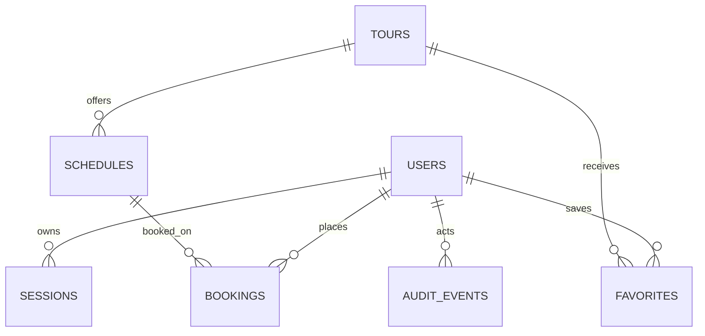

# PostgreSQL data model and booking rules

## Scope and source of truth

The runnable FastAPI application uses the seven SQLAlchemy models in
[`API/api/models.py`](../../API/api/models.py). The Alembic migration in this
folder is the versioned PostgreSQL representation of that metadata; do not
maintain another schema or apply the SQL Server scripts to this database.

The former 12-table SQL Server scripts are retained as a legacy/reference
implementation for `api.tham_sqlserver_app`, a separate read-only adapter. They
are not migrations for this PostgreSQL application.

## T03 — business entities and invariants

| Entity | Use | Main invariant / lifecycle |
|---|---|---|
| `users` | Customer/admin account, password hash and role | `CUSTOMER` by default in application; only `CUSTOMER` or `ADMIN`; email and phone unique |
| `sessions` | Login and CSRF session hashes | Persist hashes only; expires at `expires_at`; delete on logout/password change |
| `tours` | Published tour description, current VND price and listing fields | Both prices positive; price is an integer VND amount |
| `schedules` | A tour departure and seat inventory | One row per tour/departure; `0 <= reserved_seats <= total_seats` |
| `bookings` | Customer order and immutable price/contact snapshot | One idempotency key per user; valid status/counts; booking history is not cascade-deleted |
| `favorites` | User-to-tour many-to-many association | A user can favorite a tour once; removed with its user or tour |
| `audit_events` | Actor/action/subject history | Append-oriented application log; no FK to actor so history can outlive an account |

The stored application model does not yet include traveler profiles, payment
transactions, vouchers, or a dedicated admin role table. Do not invent these
as parallel structures without an approved API/model migration.

## T06 — conceptual ERD

`audit_events.actor_id` is an audit identifier, not a database FK. Primary keys
are strings/UUID strings as required by the existing ORM; money uses PostgreSQL
`BIGINT`, and timestamps use `TIMESTAMP WITH TIME ZONE` (store UTC).

## T07 — data dictionary

All columns are `NOT NULL` unless marked nullable. ORM Python defaults are
applied by the application, not database `DEFAULT` clauses.

| Table | Columns and types | Keys, indexes and constraints |
|---|---|---|
| `users` | `id VARCHAR(36)`, `full_name VARCHAR(120)`, `email VARCHAR(254)`, `phone VARCHAR(20)`, `password_hash TEXT`, `role VARCHAR(16)`, `active BOOLEAN`, `created_at TIMESTAMPTZ`, `updated_at TIMESTAMPTZ` | PK `id`; unique `phone`; unique index `ix_users_email`; role check |
| `sessions` | `token_hash VARCHAR(64)`, `user_id VARCHAR(36)`, `csrf_hash VARCHAR(64)`, `expires_at TIMESTAMPTZ`, `created_at TIMESTAMPTZ` | PK `token_hash`; FK `user_id -> users.id` ON DELETE CASCADE; index `user_id` |
| `tours` | `id VARCHAR(30)`, `slug VARCHAR(150)`, `title VARCHAR(255)`, `region VARCHAR(20)`, `duration VARCHAR(30)`, `departure VARCHAR(255)`, `transport VARCHAR(255)`, `image TEXT`, `description TEXT`, `itinerary_json TEXT`, `price BIGINT`, `original_price BIGINT`, `flash_sale BOOLEAN`, `active BOOLEAN`, `updated_at TIMESTAMPTZ` | PK `id`; unique `slug`; positive prices check |
| `schedules` | `id VARCHAR(36)`, `tour_id VARCHAR(30)`, `departure_at TIMESTAMPTZ`, `total_seats INTEGER`, `reserved_seats INTEGER`, `active BOOLEAN` | PK `id`; FK `tour_id -> tours.id` ON DELETE RESTRICT; unique `(tour_id, departure_at)`; inventory check; indexes on `tour_id`, `departure_at` |
| `bookings` | `id VARCHAR(36)`, `reference VARCHAR(30)`, `user_id VARCHAR(36)`, `schedule_id VARCHAR(36)`, `idempotency_key VARCHAR(36)`, `payload_fingerprint VARCHAR(64)`, `tour_title VARCHAR(255)`, `customer_name VARCHAR(120)`, `customer_phone VARCHAR(20)`, `customer_email VARCHAR(254)`, `note VARCHAR(500)`, `adults/children/infants/seats_held INTEGER`, `unit_price/total_price BIGINT`, `status VARCHAR(24)`, `expires_at/created_at/updated_at TIMESTAMPTZ`, `payment_evidence VARCHAR(250) NULL`, `payment_confirmed_at TIMESTAMPTZ NULL` | PK `id`; unique `(user_id, idempotency_key)`; unique index `reference`; FKs to users/schedules ON DELETE RESTRICT; status/count checks (1–20 seats, sum matches people, nonnegative VND); index `user_id` |
| `favorites` | `id VARCHAR(36)`, `user_id VARCHAR(36)`, `tour_id VARCHAR(30)`, `created_at TIMESTAMPTZ` | PK `id`; FKs to users/tours ON DELETE CASCADE; unique `(user_id, tour_id)`; index `user_id` |
| `audit_events` | `id VARCHAR(36)`, `actor_id VARCHAR(36)`, `event_type VARCHAR(60)`, `subject_id VARCHAR(36)`, `details TEXT`, `created_at TIMESTAMPTZ` | PK `id`; index `actor_id`; `details` contains JSON text from the current ORM |

Retention policy: retain bookings and audit history; do not hard-delete a user
or schedule referenced by a booking. Expired sessions and expired/cancelled
booking rows may be purged only under a separately approved retention policy;
seat-release transitions must happen before any booking purge.

## T08 — booking data flow and transaction

1. The API validates the authenticated customer, request fields and
   `Idempotency-Key`; it calculates seats and price server-side.
2. In one transaction it locks that customer's `users` row, then checks the
   idempotency key. A repeat with the same payload returns the existing booking;
   the same key with a different payload returns HTTP 409.
3. The transaction expires due holds (releasing each hold once), locks the
   selected `schedules` row `FOR UPDATE`, and checks that the tour/schedule is
   active and has enough seats.
4. It increments `reserved_seats` and inserts a `PENDING_PAYMENT` booking with
   the server price snapshot and 15-minute expiry. Both writes commit or roll
   back together.
5. Payment confirmation changes booking state but does not increment seats
   again. Cancellation/expiry releases seats exactly once in the transaction.

The customer-row lock serializes concurrent requests using the same account;
the schedule-row lock serializes competing customers. The database unique
constraint remains the final idempotency guard. Do not use a read-only quote as
an inventory reservation, and never trust price, user ID, seat count or payment
state supplied by the browser.

## T15 — integrity and concurrency verification

Run the API test suite against SQLite for fast regression tests, then run
`API/tests/test_postgres_database.py` against an empty disposable PostgreSQL
`*_test` database. It applies Alembic migrations, verifies ORM/schema parity,
and runs real database concurrency checks. The key acceptance cases are:

| Case | Expected result |
|---|---|
| Insert price `0` or negative price | Check constraint rejects |
| Insert negative/over-capacity inventory | Check constraint rejects |
| Duplicate email, phone, slug, reference, schedule departure or favorite | Unique key/index rejects |
| Booking references missing user/schedule | FK rejects |
| 20 customers compete for one seat | Exactly one booking; `reserved_seats = 1` |
| Concurrent retry of same user/key/body | Same booking returned; inventory increments once |
| Same key with changed request body | HTTP 409; no second booking |
| Cancel/expire repeated | Seat count decremented once; never negative |

The current environment has no PostgreSQL server/client installed, so a live
PostgreSQL race run is not claimed by this document. Keep the corresponding
release gate open until the test database run produces logs.
