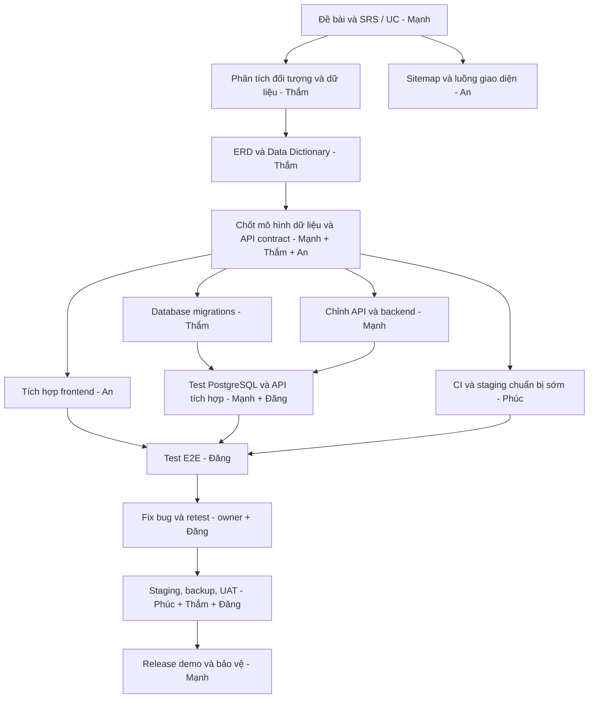

# DELTA TRAVEL 2.0 | BẢNG PHÂN CÔNG CÔNG VIỆC VÀ KẾ HOẠCH TÍCH HỢP NHÓM

> **Dự án:** Website quảng bá và đặt tour du lịch online ở Việt Nam
> **Repository chung:** https://github.com/Tham2007/Quang_ba_va_dat_tour_du_lich
> **Phiên bản tài liệu:** v1.0, đề xuất ngày 21/10/2026
> **Trạng thái:** Kế hoạch để cả nhóm rà soát và thống nhất; **không phải biên bản xác nhận các bạn đã nhận hoặc hoàn thành việc**.
> **Phạm vi nghiệm thu đề xuất:** MVP/demo học phần; không khẳng định website có thể tiếp nhận thanh toán thương mại thật.

## 1. Căn cứ và hiện trạng (kiểm tra trên nhánh `main` ngày 21/10/2026)

- Repository đã có `API/` chứa backend FastAPI do **Lê Văn Mạnh** bàn giao và được merge qua [PR #1](https://github.com/Tham2007/Quang_ba_va_dat_tour_du_lich/pull/1). Backend dùng SQLite cho demo, có xác thực, tour, lịch khởi hành, giữ chỗ/đặt tour và test; **chưa có bằng chứng tích hợp với database và frontend chính thức của nhóm**.
- `API/frontend/` là **giao diện demo của backend**, không phải phần `Frontend/` do **An** phụ trách.
- Thư mục `Frontend/` hiện chỉ có `Readme.md` gần như trống, `database/` có README giữ chỗ; **chưa thấy mã giao diện của An hoặc migrations PostgreSQL của Thắm trên `main`**. Có thể các thành viên đang làm ở máy/nhánh/repository khác.
- Tài liệu API có tại `API/docs/openapi.json`, `API/docs/THAM_DATABASE_HANDOFF.md`, `API/docs/RELEASE_GATE.md`. Chúng là **đầu vào tham khảo**, không thay thế cho bước phân tích nghiệp vụ/dữ liệu được nhóm phê duyệt.
- Bản backend đã merge không đồng nghĩa hệ thống đã hoàn thiện; kết quả kiểm thử demo cần được chạy lại sau bất kỳ thay đổi nào, nhất là khi chuyển sang PostgreSQL.

## 2. Ranh giới và trách nhiệm chính của 5 thành viên

| Thành viên | Vai trò chủ trì | Công việc sở hữu/chịu trách nhiệm cuối | Phối hợp bắt buộc | Đầu ra tối thiểu |
|---|---|---|---|---|
| **Lê Văn Mạnh** | **Trưởng nhóm, phân tích yêu cầu tổng thể, Backend/API, điều phối tích hợp** | Chốt phạm vi chức năng theo đề bài/SRS; thống nhất contract API; sửa backend khớp database; bảo mật/xác thực/phân quyền/đặt tour/giữ chỗ; review và quyết định nghiệm thu nhóm | Thắm, An, Đăng, Phúc | SRS có duyệt; bảng chức năng và API contract; mã `API/api/`; test backend; biên bản chốt release |
| **Hồng Thắm** | **Phân tích dữ liệu & thiết kế, hiện thực Database (PostgreSQL)** | Xác định đối tượng dữ liệu từ use case; thuộc tính, quan hệ, ràng buộc; ERD và data dictionary; schema/migration; seed test; backup/restore; kiểm thử tính nhất quán | Mạnh xác nhận quy tắc nghiệp vụ; An xác nhận nhu cầu hiển thị; Đăng kiểm thử | Tài liệu phân tích dữ liệu, ERD, migration, DB scripts, báo cáo kiểm thử PostgreSQL |
| **Lê Văn An** | **Frontend/UI/UX và tích hợp API** | Sitemap, flow giao diện, responsive, accessibility cơ bản; website giới thiệu/tìm kiếm/chọn tour; auth/booking/admin UI phù hợp SRS; nối API thật; xử lý loading/error | Mạnh cung cấp API contract; Thắm xác nhận dữ liệu; Đăng kiểm thử | `Frontend/` có code thật; hướng dẫn chạy; bản demo tích hợp và ảnh/chứng cứ UI |
| **Lê Hải Đăng** | **QA, kiểm thử hệ thống, quản lý lỗi và nghiệm thu kỹ thuật** | Test plan, case matrix, kiểm thử chức năng/bảo mật/đồng thời/thiết bị, báo cáo bug và retest; xác minh acceptance criteria | 4 bạn còn lại cùng cung cấp môi trường và fix | `tests/`/`qa/` có test cases, logs, bug list, báo cáo pass/fail có bằng chứng |
| **Nguyễn Văn Phúc** | **DevOps, CI/CD, staging/deploy, vận hành demo** | Cấu hình GitHub Actions, Docker/build, secrets quản lý ngoài git, máy chủ staging, HTTPS, giám sát, rollback, chuẩn bị demo và tài liệu triển khai | Mạnh cung cấp API lệnh chạy; Thắm cấp schema/migrations; An cung cấp build; Đăng kiểm tra staging | Workflow CI, staging URL có kiểm chứng, deploy guide, health check, rollback/backup rehearsal |

**Nguyên tắc một chủ trì:** Mỗi hạng mục chỉ có **một người chịu trách nhiệm chính**; người review không mặc nhiên phải làm hộ. Mạnh hỗ trợ Thắm phần **yêu cầu nghiệp vụ**, còn **Thắm chủ trì phân tích dữ liệu** và thực hiện database. **An chủ trì dựng web/frontend**. Backend Mạnh tạo trước chỉ là **mô hình kỹ thuật tạm** để phát triển song song và **phải sửa theo phân tích dữ liệu đã chốt** nếu có khác biệt.

## 3. Phạm vi tính năng MVP phải xác nhận trước khi code cuối

| Mã UC | Đối tượng | Chức năng lớn | Chức năng con / điều kiện tối thiểu | Chủ trì xác định yêu cầu | Người thực hiện chính |
|---|---|---|---|---|---|
| UC-01 | Khách truy cập | Khám phá tour | Xem danh sách, bộ lọc, tìm kiếm, chi tiết tour, ảnh, lịch trình và điều kiện dịch vụ đã được duyệt | Mạnh | An (UI), Mạnh (API), Thắm (data) |
| UC-02 | Khách hàng | Tài khoản | Đăng ký, đăng nhập, đăng xuất, xem/sửa hồ sơ, phiên đăng nhập, kiểm tra quyền | Mạnh | Mạnh (API), An (UI), Thắm (schema) |
| UC-03 | Khách hàng | Đặt tour | Chọn tour, lịch khởi hành, số người, báo giá từ server, kiểm tra số chỗ, giữ chỗ, hủy, xem đơn | Mạnh | Mạnh (API), Thắm (DB), An (UI) |
| UC-04 | Khách hàng | Yêu thích | Thêm/bỏ yêu thích gắn với tài khoản, không coi localStorage là dữ liệu gốc | Mạnh | Mạnh (API), An (UI), Thắm (DB) |
| UC-05 | Quản trị viên | Quản trị tour/lịch | CRUD phù hợp phạm vi, giá, sức chứa, ẩn/hiện, audit, phân quyền | Mạnh | Mạnh (API), Thắm (DB), An (UI) |
| UC-06 | Quản trị viên/khách | Trạng thái đơn | Pending/cancel/expire/paid chỉ theo quy trình backend được xác thực | Mạnh | Mạnh (API), Thắm (DB), An (UI) |
| UC-07 | Khách truy cập | Hỗ trợ thông tin | FAQ/quy định/chính sách, ghi rõ trợ lý theo quy tắc nếu chưa có AI API | Mạnh | An (UI), Mạnh (backend) |
| UC-08 | Nhóm phát triển | Chất lượng và vận hành | Test, CI, staging, HTTPS, logging, backup & rollback theo phạm vi demo | Mạnh | Đăng (QA), Phúc (DevOps) |

**Chưa mặc định thuộc phạm vi hoàn thành:** thanh toán ngân hàng/cổng VNPay/MoMo tự động, vé điện tử thật, mã giảm giá phức tạp, realtime WebSocket, dịch vụ email/SMS, AI gọi API thật, đặt tour cho khách hàng thương mại. Nếu đề bài bắt buộc bất kỳ mục nào, Mạnh phải mở yêu cầu thay đổi, nêu chủ trì/nguồn lực, kiểm thử và điều kiện nghiệm thu. **Không cho khách tự đánh dấu đơn là đã thanh toán, không nhập/lưu CVV.**

## 4. Bảng công việc chi tiết theo đúng trình tự phụ thuộc

**Ký hiệu:** `P0` = chặn tích hợp/điểm nghiệm thu; `P1` = quan trọng; `P2` = cải thiện sau MVP. `S0` đến `S6` là giai đoạn, không phải ngày đã chốt. `Chưa nghiệm thu` có nghĩa repository/chứng cứ hiện tại chưa đủ để xác nhận hoàn thành, **không kết luận thành viên chưa làm trên máy**.

| ID | Giai đoạn | P | Hạng mục cụ thể | Chủ trì | Phối hợp / review | Đầu ra bắt buộc & tiêu chí hoàn thành | Phụ thuộc | Trạng thái ghi nhận |
|---|---|---|---|---|---|---|---|---|
| T01 | S0 | P0 | Thu thập đề bài, quy định thầy, SRS và tiêu chí chấm; đánh dấu yêu cầu chắc chắn/chưa rõ | Mạnh | Cả nhóm | `docs/requirements/SRS.md`, nguồn yêu cầu, danh sách câu hỏi còn mở | Không | Cần nhóm duyệt |
| T02 | S0 | P0 | Xác định actors, mục tiêu, sơ đồ use case, nghiệp vụ và phạm vi MVP | Mạnh | Thắm, An | `docs/requirements/USE_CASES.md`, luồng chuẩn và luồng lỗi, review đồng thuận | T01 | Cần nhóm duyệt |
| T03 | S0 | P0 | Danh sách thực thể nghiệp vụ, dữ liệu cần cho từng UC, quy tắc dữ liệu | Thắm | Mạnh, An | `docs/analysis/DATA_REQUIREMENTS.md`: đối tượng, thuộc tính, nghiệp vụ tạo/sửa/xóa/đọc | T02 | Chưa nghiệm thu |
| T04 | S0 | P1 | Sitemap, wireframe và ma trận màn hình theo UC | An | Mạnh, Thắm | `docs/ui/SCREEN_MAP.md`, từng màn hình trỏ tới UC và dữ liệu API | T02 | Chưa nghiệm thu |
| T05 | S0 | P1 | Ma trận truy vết UC ↔ màn hình ↔ API ↔ bảng ↔ test | Mạnh | Cả nhóm | `docs/requirements/TRACEABILITY.md`, không còn UC P0 vô chủ | T02-T04 | Chưa nghiệm thu |
| T06 | S1 | P0 | ERD khái niệm và logic cho users, sessions, tours, schedules, bookings, favorites, audit | Thắm | Mạnh | `database/erd/ERD.md` (Mermaid hoặc PNG), PK/FK/cardinality, review | T03 | Chưa nghiệm thu |
| T07 | S1 | P0 | Data dictionary: kiểu dữ liệu, null/default, tiền VND, thời gian UTC, status, unique/index, vòng đời bản ghi | Thắm | Mạnh, Đăng | `database/docs/DATA_DICTIONARY.md`, mọi field/constraint giải thích được | T06 | Chưa nghiệm thu |
| T08 | S1 | P0 | Mô hình luồng dữ liệu và transaction: giá, số chỗ, tạo đơn, giữ/hết hạn/hủy, quản trị | Thắm | Mạnh, Đăng | `database/docs/DATA_FLOW.md` + invariants; xử lý cạnh tranh/rollback rõ ràng | T06-T07 | Chưa nghiệm thu |
| T09 | S1 | P0 | Chốt data model với `API/api/models.py`: giải quyết sai khác và ghi quyết định | Mạnh | Thắm, An | `docs/decisions/ADR_DATA_API.md`, danh sách field đổi, tác động UI/API/test | T07-T08 | Chưa nghiệm thu |
| T10 | S2 | P0 | Chuẩn hóa hợp đồng API theo UC và data đã duyệt | Mạnh | Thắm, An, Đăng | OpenAPI được duyệt, request/response/status codes, auth, phân trang, lỗi, naming | T09 | Có API demo, chưa chốt tích hợp |
| T11 | S2 | P0 | Quy định luồng thanh toán demo, ranh giới thương mại và trạng thái đơn | Mạnh | Thắm, An, Đăng | `docs/requirements/PAYMENT_SCOPE.md`: pending, paid, cancel, expire; không fake PAID | T02,T08 | Chưa nghiệm thu |
| T12 | S2 | P1 | Test plan và test case từ SRS, ưu tiên P0 trước khi sửa code | Đăng | Mạnh, Thắm, An | `qa/TEST_PLAN.md`, `qa/TEST_CASES.md`, coverage và expected result | T02,T10 | Chưa nghiệm thu |
| T13 | S2 | P1 | Cài quy tắc Git, PR, review, naming và branch protection theo quyền chủ repo | Phúc | Mạnh, Thắm | `docs/CONTRIBUTING.md`, checklist PR và ít nhất 1 PR mẫu theo quy trình | T01 | Chưa nghiệm thu |
| T14 | S3 | P0 | Schema PostgreSQL, Alembic migrations upgrade/downgrade; không chỉnh DB thủ công | Thắm | Mạnh | `database/migrations/`, hướng dẫn migrate fresh, schema khớp ORM | T09 | Chưa nghiệm thu |
| T15 | S3 | P0 | Ràng buộc DB: unique, FK, checks giá/chỗ/status, index; quản lý dữ liệu cá nhân | Thắm | Mạnh, Đăng | SQL/migration + test invariant, không oversell và không cascade delete đơn | T14 | Chưa nghiệm thu |
| T16 | S3 | P0 | Seed dữ liệu mẫu an toàn, idempotent, không mật khẩu cứng/khách thật | Thắm | Mạnh, Đăng | `database/seed/` + hướng dẫn và kiểm tra chạy lại không trùng | T14 | Chưa nghiệm thu |
| T17 | S3 | P0 | Sửa DB engine/transaction của FastAPI để dùng PostgreSQL đúng chuẩn | Mạnh | Thắm, Đăng | API chạy bằng `DATABASE_URL` của môi trường test, SQL transaction đúng, test pass | T14-T15 | API demo đã merge, chưa nghiệm thu Postgres |
| T18 | S3 | P0 | Xác thực/phân quyền, CSRF, validation, bảo vệ thông tin cá nhân và IDOR | Mạnh | Đăng | Test trái quyền trả 401/403/404 đúng; không lộ secrets/log nhạy cảm | T10,T17 | Có mã demo; cần retest |
| T19 | S3 | P0 | Tính giá server và booking atomic: seat lock, idempotency, cancel/expire | Mạnh | Thắm, Đăng | Test cạnh tranh PostgreSQL (ít nhất 20 yêu cầu/1 ghế), không oversell | T15,T17 | Có mã demo; chưa test Postgres |
| T20 | S3 | P0 | Admin quản lý tour/lịch/giá với audit và trạng thái thanh toán an toàn | Mạnh | Thắm, Đăng | Role admin, thay giá không đổi snapshot đơn cũ; không đánh dấu PAID từ client | T17-T19 | Có mã demo; cần retest |
| T21 | S3 | P0 | Chuyển giao diện thật từ nguồn An vào thư mục `Frontend/` repo chung | An | Mạnh, Phúc | HTML/CSS/JS/assets đầy đủ, `README` chạy được, không chỉ README placeholder | T04,T13 | Chưa thấy code trên main |
| T22 | S3 | P0 | Tích hợp auth/profile/favorites/frontend session theo API | An | Mạnh, Đăng | Đăng ký/đăng nhập/đăng xuất/hồ sơ/yêu thích dùng server; xóa localStorage làm nguồn sự thật | T10,T21 | Chưa nghiệm thu |
| T23 | S3 | P0 | Tích hợp trang tour/tìm kiếm/lọc/chi tiết, lịch và báo giá server | An | Mạnh, Thắm | UI đọc giá/chỗ từ server, loading/empty/error state, không giá hardcode quyết định đơn | T10,T21 | Chưa nghiệm thu |
| T24 | S3 | P0 | Tích hợp luồng đặt/hủy/xem đơn và giao diện trạng thái thanh toán | An | Mạnh, Đăng | Booking gửi đúng API, chặn double-submit, không giả PAID/e-ticket | T11,T19,T21 | Chưa nghiệm thu |
| T25 | S3 | P1 | Giao diện quản trị cơ bản và trang FAQ | An | Mạnh, Đăng | Chỉ hiện công cụ admin khi đúng role; kiểm thử thao tác quản trị/FAQ | T20,T21 | Chưa nghiệm thu |
| T26 | S3 | P1 | Responsive/mobile, lỗi console, khả năng truy cập cơ bản, link và ảnh | An | Đăng | Kiểm tra 360/390/768/1440px; keyboard focus, alt, tương phản, không vỡ layout | T21-T25 | Chưa nghiệm thu |
| T27 | S3 | P0 | GitHub Actions CI: lint/syntax, unit+integration tests, check secrets | Phúc | Mạnh, Đăng | `.github/workflows/ci.yml` chạy xanh trên PR; chỉ chạy trên code demo an toàn | T13,T17 | Chưa thấy workflow trên main |
| T28 | S3 | P0 | Docker/build và môi trường staging, config dùng secrets qua dashboard | Phúc | Mạnh, An, Thắm | Chạy staging từ repo chung đúng nhánh; health endpoint, log build, URL kiểm chứng | T17,T21,T27 | Chưa nghiệm thu |
| T29 | S4 | P0 | QA tích hợp theo use case trên staging, báo lỗi có bước tái hiện | Đăng | Cả nhóm | `qa/BUG_REPORT.md`, evidence ảnh/log, liên kết issue, test pass/fail | T22-T24,T28 | Chưa nghiệm thu |
| T30 | S4 | P0 | Kiểm thử bảo mật auth/session/CSRF, XSS, input, IDOR, dữ liệu chéo tài khoản | Đăng | Mạnh, An | Báo cáo từng case; không còn lỗ hổng P0/P1 chưa khắc phục | T18,T28 | Chưa nghiệm thu |
| T31 | S4 | P0 | Test đồng thời PostgreSQL, hết hạn/hủy/giữ chỗ, retry và đối soát tồn | Đăng | Thắm, Mạnh | Log 20 yêu cầu cạnh tranh 1 ghế; 1 thành công, không âm/vượt chỗ, retry đúng | T19,T28 | Chưa nghiệm thu |
| T32 | S4 | P1 | Cross-browser, mobile, thao tác người dùng đầu-cuối; regression sau fix | Đăng | An, Mạnh | Checklist Chrome/Edge + viewport, màn hình/chức năng được thử, bug/ảnh | T26,T28 | Chưa nghiệm thu |
| T33 | S4 | P0 | Sửa lỗi theo owner; xác nhận regression, review schema/contract change | Mạnh | Owner liên quan và Đăng | Mọi issue P0/P1 đóng bằng commit + kết quả retest; không xóa lỗi khỏi report | T29-T32 | Chưa nghiệm thu |
| T34 | S5 | P0 | Backup/restore DB, migration/rollback rehearsal có bằng chứng | Thắm | Phúc, Đăng | `database/docs/BACKUP_RESTORE.md` + log khôi phục trên DB test, không upload dữ liệu thật | T14,T28 | Chưa nghiệm thu |
| T35 | S5 | P0 | CI/CD deploy staging, HTTPS, env secrets, health check, rollback | Phúc | Mạnh, Thắm, Đăng | `docs/DEPLOYMENT.md`, URL staging, workflow, cách rollback và nhật ký chạy | T27,T28,T34 | Chưa nghiệm thu |
| T36 | S5 | P1 | Smoke test sau deploy, giám sát lỗi, ghi log không lộ bí mật | Phúc | Đăng, Mạnh | `qa/DEPLOY_SMOKE.md`, URL/commit, HTTP status, ảnh chứng minh | T35 | Chưa nghiệm thu |
| T37 | S6 | P0 | UAT theo SRS và ma trận traceability, xác nhận P0 đều đạt | Đăng | Mạnh + cả nhóm | `qa/UAT_REPORT.md`, các case Passed/Failed/Blocked, chữ ký/đồng thuận nhóm | T33,T36 | Chưa nghiệm thu |
| T38 | S6 | P0 | Tổng hợp tài liệu báo cáo, kiến trúc, ảnh demo, giải thích luồng hệ thống | Mạnh | Cả nhóm | `docs/FINAL_REPORT.md`, link PR/test/staging, ảnh nguồn gốc rõ ràng | T37 | Chưa nghiệm thu |
| T39 | S6 | P0 | Kiểm tra release gate và quyết định phạm vi demo trước ngày bảo vệ | Mạnh | Thắm, An, Đăng, Phúc | `docs/RELEASE_DECISION.md`: GO/NO-GO, rủi ro tồn, phiên bản/commit | T37-T38 | Chưa nghiệm thu |
| T40 | S6 | P1 | Tập dượt bảo vệ: mỗi người trình bày phần mình, hỏi đáp tích hợp | Mạnh | Cả nhóm | Video/ảnh buổi rehearsal, câu hỏi phản biện + câu trả lời | T39 | Chưa nghiệm thu |

### Nguyên tắc review các file nhạy cảm

- `API/api/` **Mạnh** chủ trì. Thắm chỉ thay đổi mã ở đây khi cần sửa migration/ORM và phải có Mạnh review.
- `database/` **Thắm** chủ trì. Mọi thay đổi schema phải có **Mạnh** review; thay đổi data shape còn cần **An** xem tác động.
- `Frontend/` **An** chủ trì. Mạnh review điểm gọi API/auth/payment, Đăng kiểm tra hành vi.
- `qa/` và test plan **Đăng** chủ trì. Không cho tác giả tính năng tự đánh dấu test của mình là Passed nếu chưa có bằng chứng độc lập.
- `.github/workflows/`, staging/config/deploy **Phúc** chủ trì. Không ghi secrets, .env thật, token, database khách hàng lên repository public.
- Các quyết định có tác động qua 2 nhóm phải có **ít nhất review của 2 vai trò bị ảnh hưởng**, Mạnh điều phối.

## 5. Trình tự đúng và khả năng làm song song

**Giải thích thứ tự:** Đúng là phân tích use case và **phân tích dữ liệu đi trước khi chốt database**. Tuy nhiên, có thể viết **API prototype song song** nhằm xác nhận chức năng; API ấy không phải schema chính thức và phải điều chỉnh sau khi thống nhất ERD/data dictionary. Frontend có thể làm layout bằng mock data trong thời gian chờ contract, nhưng **không được gọi mock/localStorage là tích hợp thật**.

## 6. Lịch đề xuất tương đối, không giả định ngày nộp

> D0 là **ngày cả nhóm thông qua kế hoạch**, không mặc định D0 = 21/10/2026. Đây là lịch tham khảo 14 ngày làm việc cho MVP nhỏ; nếu thầy đặt deadline khác, Mạnh cập nhật `docs/PLAN.md` sau khi hỏi nhóm, không tự ấn định ngày từng bạn phải xong.

| Mốc tương đối | Cửa kiểm soát | Chủ trì báo cáo | Yêu cầu chốt để qua mốc |
|---|---|---|---|
| D0-D1 (S0) | Requirements baseline | Mạnh | T01-T05, thống nhất UC P0 |
| D2-D3 (S1) | Data/ERD baseline | Thắm | T06-T09, Mạnh/An review data mapping |
| D4 (S2) | Contract freeze v1 | Mạnh | T10-T13, endpoint và test case chính rõ ràng |
| D5-D9 (S3) | Implementation/integration | Thắm, Mạnh, An, Phúc | T14-T28, có PR và test/staging bước đầu |
| D10-D11 (S4) | Quality gate | Đăng | T29-T33, P0/P1 đã xử lý và retest |
| D12 (S5) | Staging & recovery gate | Phúc + Thắm | T34-T36, có log/URL/backup restore test |
| D13-D14 (S6) | UAT và bảo vệ | Mạnh + Đăng | T37-T40, release demo theo phạm vi được duyệt |

### Bắt buộc khi công việc bị chặn

Ghi rõ trong issue/nhóm: `Đang bị chặn bởi [ID/tên công việc]`, lý do, ai cần phản hồi, link evidence, thời điểm cần phản hồi. Không ghi “xong” nếu chưa có PR và bằng chứng chạy; không phạt bạn đang bị phụ thuộc chưa được bàn giao.

## 7. Quy trình GitHub chuẩn cho từng thành viên

**Repo:** `https://github.com/Tham2007/Quang_ba_va_dat_tour_du_lich`
**Nhánh mặc định:** `main`
**Không force push vào main; không commit code trực tiếp main nếu có PR review.**

Quy ước nhánh gợi ý:

| Thành viên | Nhánh gợi ý | Ví dụ path |
|---|---|---|
| Mạnh | `feature/manh-api-...` hoặc `fix/manh-...` | `API/`, `docs/requirements/` |
| Thắm | `feature/tham-data-...` | `database/` |
| An | `feature/an-frontend-...` | `Frontend/` |
| Đăng | `test/dang-qa-...` | `qa/`, `API/tests/` |
| Phúc | `ci/phuc-deploy-...` | `.github/workflows/`, `docs/DEPLOYMENT.md` |

**Mỗi Pull Request phải có:** mục tiêu và mã Txx; danh sách file đổi; screenshot/log/test output; liên kết issue; hướng dẫn chạy; ảnh hưởng API/database; cách rollback (nếu có); reviewer. Chỉ merge khi review cần thiết và CI đạt, hoặc mọi ngoại lệ được ghi thành quyết định minh bạch.

**Nhắc an toàn:** repository đang **public**. Không upload `.env`, mật khẩu, API key, access token, chứng từ thanh toán, dữ liệu cá nhân thật, file backup `.sql` chứa dữ liệu thật, dump DB, ảnh giấy tờ hoặc SSH private key.

## 8. Mẫu báo cáo tiến độ chung, thống nhất cách hiểu

Mỗi thành viên cập nhật cuối mỗi mốc/mỗi buổi nhóm thống nhất (không yêu cầu luôn online):

| Họ tên | ID việc đang làm | Trạng thái (`Todo / Doing / Blocked / In review / Done`) | PR/commit/evidence | Phụ thuộc hoặc vấn đề | Việc kế tiếp |
|---|---|---|---|---|---|
| Mạnh | T01, T09, T10, T17-T20, T38-T39 | Cần tự cập nhật | PR #1 backend đã merge; chưa phải tích hợp xong | Cần phân tích dữ liệu & frontend thật | Chốt SRS và API contract |
| Thắm | T03, T06-T08, T14-T16, T34 | Cần tự cập nhật | Chưa thấy bản DB thật trên main tại ngày rà soát | Cần UC/SRS được duyệt | Data requirements và ERD |
| An | T04, T21-T26 | Cần tự cập nhật | Chưa thấy frontend thật trên main | Cần UC/API contract | Sitemap và PR frontend |
| Đăng | T12, T29-T32, T37 | Cần tự cập nhật | Có test demo `API/tests/`, chưa thấy QA report độc lập | Cần staging và build tích hợp | Test plan |
| Phúc | T13, T27-T28, T35-T36 | Cần tự cập nhật | Có CI mẫu `API/docs/ci-workflow-template.yml`, chưa thấy workflow chạy | Cần cấu hình repo và app tích hợp | CI chạy PR, staging |

**Định nghĩa Done:** (1) đầu ra có thật trong repo/đường dẫn nhóm duyệt, (2) chạy/kiểm thử có bằng chứng, (3) reviewer chấp nhận, (4) không còn issue nghiêm trọng thuộc phạm vi công việc, (5) tài liệu chạy lại cập nhật. Đã viết code nhưng chưa tích hợp/chưa review ghi `In review`, không tự ghi `Done`.

## 9. Checklist nghiệm thu tổng thể cho demo học phần

- [ ] Tài liệu đề bài/SRS, use cases và ma trận truy vết được nhóm thống nhất.
- [ ] ERD, data dictionary, ràng buộc nghiệp vụ, migration PostgreSQL khớp API.
- [ ] Backend + PostgreSQL chạy cùng nhau và được kiểm thử trên PostgreSQL thật.
- [ ] Frontend thật của An được commit vào repo chung và sử dụng API server.
- [ ] Đăng ký/đăng nhập/logout/hồ sơ, tìm tour, chi tiết, lịch, đặt/hủy/xem đơn hoạt động E2E.
- [ ] Không có thanh toán giả, không thu CVV, không để client quyết định giá/tồn chỗ/PAID.
- [ ] Test phân quyền, IDOR, CSRF, concurrency, retry/idempotency, hết hạn và rollback đạt.
- [ ] CI xanh trên commit ứng viên; staging hoạt động; môi trường không chứa secrets công khai.
- [ ] PostgreSQL backup/restore và quy trình rollback được thử trên dữ liệu giả.
- [ ] QA/UAT report đã có kết quả và bằng chứng, không còn P0/P1 chưa xử lý đối với phạm vi demo.
- [ ] Báo cáo kiến trúc và demo có thể chạy lại trên máy thầy/nhóm bằng README.
- [ ] Chủ nhóm ghi rõ các tính năng *demo* và *chưa hỗ trợ*; không khẳng định vận hành thương mại nếu chưa đạt release gate.

## 10. Tiêu chí dừng triển khai, tránh rủi ro và quyết định cần nhóm xác nhận

**NO-GO** nếu thiếu schema được duyệt, không chạy được migration, có đặt trùng/oversell, tự đánh dấu đã thanh toán, rò rỉ mật khẩu/token, IDOR hoặc CSRF nghiêm trọng, lỗi build trên staging, không có review cho sửa đổi dữ liệu ảnh hưởng tiền/chỗ.

**Quyết định cần chốt ở cuộc họp gần nhất:** (a) đề bài/SRS và phạm vi bắt buộc, (b) ngày bảo vệ/deadline thực tế, (c) bản UI của An sẽ dùng làm nguồn chính, (d) DB PostgreSQL dùng instance nào và ai có quyền truy cập, (e) thanh toán chỉ demo hay bắt buộc sandbox, (f) môi trường staging của nhóm và quyền GitHub reviews, (g) mức thời gian mỗi bạn có thể cam kết.

**Người duyệt cuối:** Lê Văn Mạnh, trưởng nhóm, **sau khi** có xác nhận review của Thắm (data), An (frontend), Đăng (QA), Phúc (deploy).

---

*Phân công này là phương án điều phối dựa trên những gì có trong repository đến ngày kiểm tra và vai trò đã thảo luận. Các giả định, lịch tương đối và đầu ra mới là đề xuất cần cả nhóm thông qua, không phải kết luận đã hoàn thành. Tất cả thay đổi sau khi chốt SRS phải ghi trong PR/issue để truy vết.*
